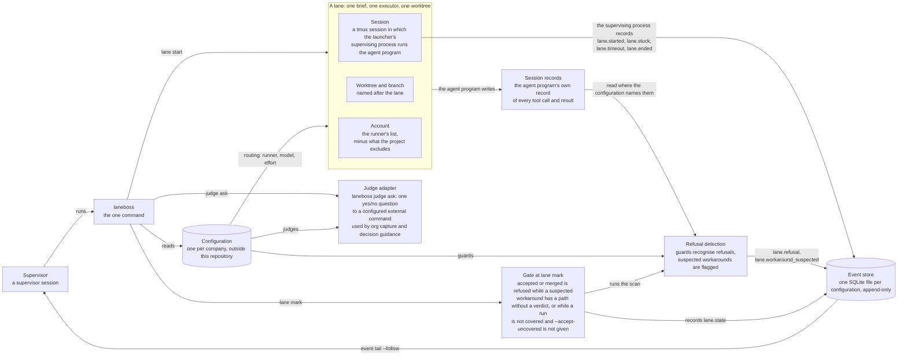
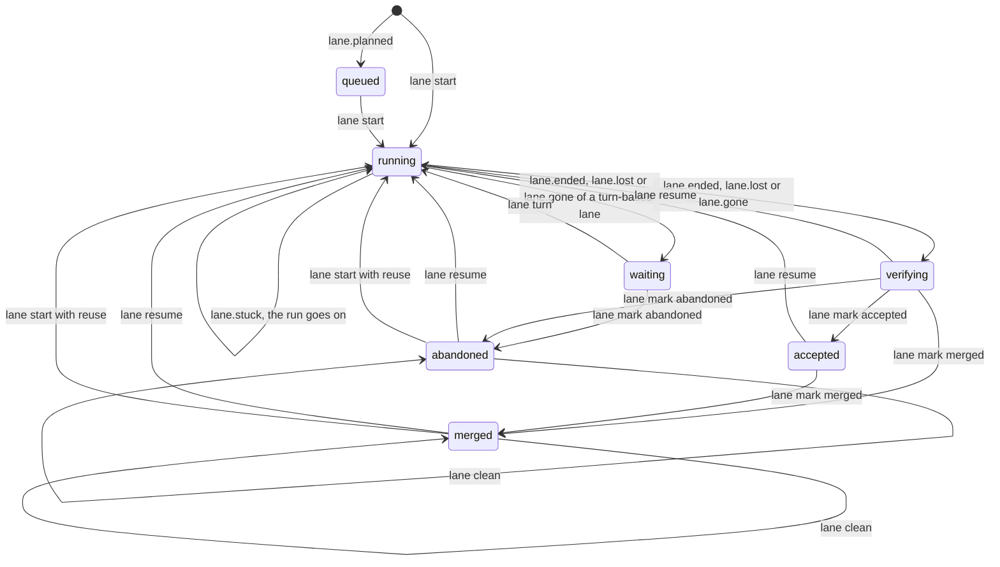
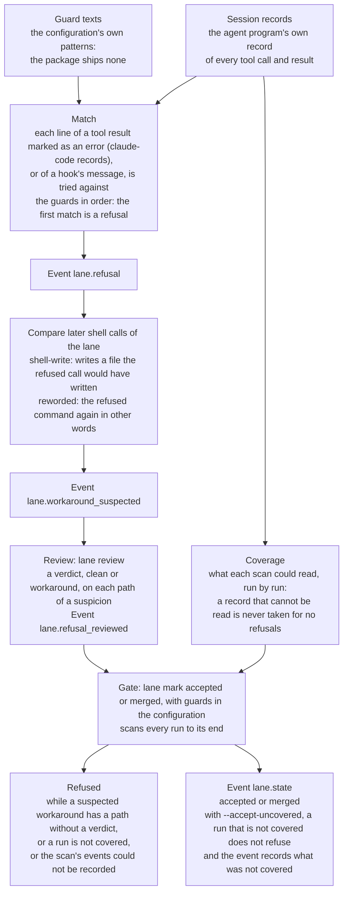
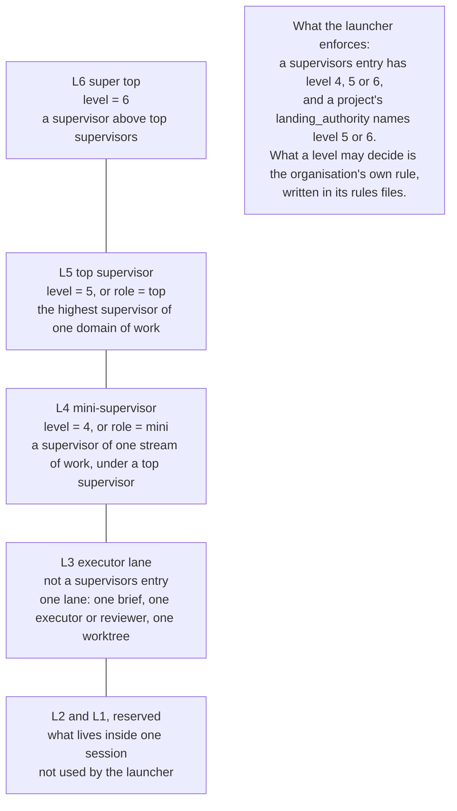

# Laneboss

**This development tree is the incomplete isolation-first v2 rebuild.** The
installed command entry uses the typed v2 socket dispatcher and reports
`implementation: v2-incomplete`. Common file-backed requests, composition and
record ports are under implementation; service, isolation, worker and vendor
dependencies still contain explicit failing stubs. This tree is not a working
replacement for the released launcher and has no release acceptance evidence.
The 1.0.0 release was cancelled. The feature descriptions, install commands and
screenshots below describe retained legacy behavior to port, not a v2 pass.
See the [contracts](docs/design/v2-contracts.md) and
[integration gates](docs/design/v2-lanes.md) for current ownership and status.
Self-hosted Clef-flash is the decided default judge under R108; TypeSafe Jev
remains an explicitly selected alternative.

**Laneboss is a launcher for supervised agent lanes: a supervisor session hands each piece of work to an executor in
its own worktree, and the launcher records what happens to it, so that the supervisor learns it from events and not
from the executor's own report.**

*Version 0.7.0. Interfaces can still change. What is built is in
[What is built](#what-is-built).*

Install Laneboss and claudock-cli on Linux or macOS (amd64 or arm64):

```sh
curl -fsSL https://raw.githubusercontent.com/laneboss-io/laneboss/main/install.sh | sh
```

The default install uses checksum-verified release binaries and needs no Go toolchain.
Use `--without-claudock` for Codex-only setups or `--from-source` to build instead
([installation options](#install)).

## What you get

Laneboss gives a supervisor the tools to dispatch work, follow its progress and review the evidence:

- **Portable releases:** one Go launcher with SQLite included, prebuilt for Linux and macOS on amd64 and arm64, with checksum verification before installation ([install guide](docs/install.md)).
- **Your choice of agent:** claudock-cli is installed by default and recommended for Claude users with several profiles; direct Claude Code and Codex runners have their own setup examples ([runner guide](docs/getting-started.md#use-a-real-agent), [portable claudock setup](docs/claudock.md#portable-cli-setup)).
- **Setup in one command:** `laneboss init` creates a named configuration, a project per existing Git repository, an L3–L6 org, supervisor instances and rendered hooks, selecting an installed runner without starting an agent ([quick start](docs/getting-started.md#quick-start)).
- **Work in separate lanes:** start, watch, resume and collect worktrees with file-backed briefs, budgets, kept inputs and an append-only event record; turn-based lanes also have mail, scheduled turns and a terminal view ([lane guide](docs/architecture.md#lanes)).
- **Shared rules and refusal review:** protocol 1.3.0 and org hooks give sessions common rules; configured raw-record scans identify guard refusals and suspected workarounds for a supervisor to review before acceptance ([hook guide](docs/org-hooks.md), [refusal guide](docs/architecture.md#refusals)).
- **Roles with clear responsibilities:** the built-in library includes executor, reviewer, tester, docs and researcher roles plus supervisors for L4–L6; editable templates specify what each role delivers and which runner programs it may use at each level ([role library and driver rules](docs/org.md#role-library-and-lane-roles)).
- **Reporting lines and peers:** lanes record their level and starter, receive reporting instructions in their briefs, and use `laneboss report` to report upward through installed channels; peer messages require the same recorded level and supervisor ([org guide](docs/org.md#role-library-and-lane-roles), [dashboard and message rules](docs/dashboard.md)).
- **Recorded caller identity:** process ancestry and terminal records identify who issued a command; a headless supervisor registers with `laneboss start --role` before dispatching work ([identity setup](docs/configuration.md#supervisorsname), [current limits](#what-is-built)).
- **A live local dashboard:** a human opens `laneboss dashboard --config NAME --port 0` to follow the org graph, lane activity, refusals, messages, logs, decisions and judge results, with English/Traditional Chinese labels and light/dark themes; requests require the per-run token ([dashboard guide](docs/dashboard.md)).
- **Owner messages from Discord:** the receive-only gateway filters registered L5/L6 channels and allowed senders, preserves their configured authority and supports reconnect/resume while its session remains available ([gateway guide](docs/org-discord.md#run-the-gateway)).
- **An owner decision sheet:** an optional `.xlsx` queue in a synced folder preserves answers and notes by ID, supports English and Traditional Chinese, and lets a supervisor acknowledge handled answers ([sheet guide](integrations/owner-sheet/README.md)).
- **Decision memory:** an org can keep recorded decisions and scoped past cases, inject relevant history and capture clear owner decisions with provenance ([org history](docs/org-history.md), [decision store](docs/decisions.md)).
- **Decision guidance:** applicable decisions open briefs and turns; TypeSafe-compatible judge scores warn at 0.5 by default. Score-based refusal requires the org to set `refuse_threshold`. A decided question returns its recorded answer ([guidance](docs/decisions.md#guiding-agents)).
- **TypeSafe job guidance:** org rendering generates the command catalog from CLI syntax, levels and role sources. Baseline-allowed shell calls use the same configured judge and default warning threshold; a separate `jobs_refuse_threshold` enables refusal only on recorded managed targets. Stale catalogs and unavailable judges keep the baseline with a notice ([hook jobs](docs/decisions.md#laneboss-jobs-at-the-hook), [standalone generator](scripts/laneboss_jobs.py)).

Laneboss is generic: it holds no company settings, credentials or state. A configuration names the secrets it needs
and never holds one.

## Demo

Synthetic demo using the credential-free demo-agent with shop-api and shop-web.
Captured with headless Chromium on a disposable Ubuntu box. The dashboard runs
as the human principal under a Python pseudo-terminal because the box has no
interactive terminal. This is not an authenticated AI-service test.


Demo org: recorded and running L5/L4 supervisor instances, model names and activity.


Five L3 lanes under the L4 stream, with Running, Verifying and Ended states.


Demo API lane: recorded L3 level, instance:stream-lead report line and parsed timeline.


Demo API events: start, resume, acceptance, merge decision and collection history.

How the capture works and its privacy checks: [the capture guide](docs/assets/README-shots.md).

## How it fits together

A supervisor session plans work and hands it to mini-supervisors, executors and reviewers. A lane is one such unit of
work, with one brief, one executor and one worktree. The layers of sessions have levels, a larger number meaning a
higher level (L3 executor lane, L4 mini-supervisor, L5 top supervisor, L6 super top;
[Levels](docs/getting-started.md#levels)).



The supervisor session works through the `laneboss` command, which reads the configuration and starts lanes; each
lane's supervising process records what happens to its runs as events in the event store; refusal detection reads each
lane's raw session records for guard refusals; the gate at `lane mark` (with guards in the configuration) refuses to
accept a lane while a suspected workaround has a path without a verdict, or while a run is not covered and
`--accept-uncovered` is not given; and the judge adapter asks a configured external command one yes/no question,
logging requests and outcomes. Org decision capture and guidance use that judge machinery when configured.

## One lane, start to finish

The [getting-started walkthrough](docs/getting-started.md) follows the Go launcher, `0.7.0`,
from a file-backed brief through two runs and collection. Each command has expected output and an
assertion that checks the launcher's actual result.

`laneboss start --config example --role top` prints the supervisor's briefing and records its calling session's
identity without appending an event. Run it from the persistent session that will issue later commands. The supervisor
reads it, then dispatches with `lane start --role executor`, which selects an org-owned role, renders the brief,
selects the runner, model and account, creates the lane's worktree and branch, and returns after the run starts in
tmux. The supervisor follows events, checks the
end reason, exit code, surviving processes and output, and can use `lane resume` before collection. Following a
resumed run needs `event tail --since` so an earlier end event cannot stop the follow prematurely.

After reviewing the work, the supervisor records its decision with `lane mark`. Marking `merged` records a state;
it does not merge Git commits or deploy. `lane clean` first verifies an archive, then collects a stopped, merged or abandoned lane's clean managed
worktree without force; a merged branch is removed when Git agrees it is merged, while the lane's events and kept
inputs remain. A missing or unowned worktree is kept while its lane's report/logs are archived;
lane supervisors collect only recorded lower-level descendants from the same lane lives. A cleaned lane cannot resume.

## Install

Install Laneboss and claudock-cli on Linux or macOS (amd64 or arm64), without Go:

```sh
curl -fsSL https://raw.githubusercontent.com/laneboss-io/laneboss/main/install.sh | sh
```

The bootstrap follows GitHub's latest-release redirect, downloads
`laneboss_VERSION_OS_ARCH.tar.gz` and `SHA256SUMS` from that release, and checks the archive's SHA-256
before unpacking or running it. Each archive includes the binary, LICENSE, README, Claude Code plugins,
and the Discord gateway script with its run guide.
After Laneboss is installed, it downloads claudock-cli `0.1.0` for the same OS and architecture from
its own release and verifies that archive against its own `SHA256SUMS` through the same code path.
Both commands are installed in the selected prefix's `bin` directory.
It requires curl, tar, gzip and either sha256sum or shasum; a missing checksum or mismatch stops the install.
Use `sh -s -- --version 0.7.0` after the pipe to select this release, or `--prefix DIR` to install elsewhere.
The bootstrap itself comes from `main` over HTTPS; release checksums detect corruption but are not signatures.
See [docs/install.md](docs/install.md) for the full trust boundary and local release checks.

Codex-only users can skip claudock completely:

```sh
curl -fsSL https://raw.githubusercontent.com/laneboss-io/laneboss/main/install.sh | sh -s -- --without-claudock
```

An existing claudock at the pinned version is kept. A different version is kept with a clear message
unless `--upgrade-claudock` is passed. Download, checksum or publication failures in the claudock step
exit nonzero; Laneboss has already finished installing. Installation creates no profiles and signs in to
no service. For Claude, use [claudock profiles and the claudock runner](docs/getting-started.md#use-claudock-cli-for-a-real-agent).
The guide also documents direct `claude` and `codex` runners.

To build from source instead (requires Go, with the pinned Go 1.26.0 toolchain):

```sh
curl -fsSL https://raw.githubusercontent.com/laneboss-io/laneboss/main/install.sh | sh -s -- --from-source
```

Or build from a checkout:

```sh
git clone https://github.com/laneboss-io/laneboss.git laneboss
cd laneboss
LANEBOSS_SOURCE=. sh ./install.sh --from-source
export PATH="$HOME/.local/bin:$PATH"
laneboss --version
```

Both install routes keep immutable versions under `~/.local/share/laneboss/versions` and link
`~/.local/bin/laneboss` to the selected version, without administrator rights. Plugin files are installed beside
the binary and located by `laneboss plugin path`. Source builds download missing toolchains and modules;
`LANEBOSS_GO` selects the Go executable. Git and tmux are needed for lanes (`doctor` checks them).
The lower-level `sh scripts/install.sh` builds and installs only Laneboss, as used by the source walkthrough.

## Quick start

After installing, put `claudock`, `claude` or `codex` on `PATH` and run in an
unbound shell with existing Git working repositories:

```console
laneboss init myorg --project ~/code/a --project ~/code/b
laneboss start --config myorg --role top
```

Init creates the named configuration, a project per repository, an L3–L6 org,
supervisor instances and rendered hooks. It announces its runner choice
(`claudock`, then `claude`, then `codex`) and every created path. `--runner`
chooses explicitly; `--top-level 6` selects L6 instead of L5. Existing orgs
and configurations are preserved; init stages its files and rolls back an
ordinary failure. It starts no agent, contacts no service and writes no account
or secret. The owner supplies their Claudock profile names before dispatch.
`start` prints the supervisor briefing. The guide explains setup and limits
under **What init does, step by step**.

Use the [getting-started guide](docs/getting-started.md) for the complete Linux/macOS walkthrough with commands,
expected outputs and failure recovery. An AI agent should also read the matching [AGENTS.md checklist](AGENTS.md),
which states its authority and the evidence required at each step.

From a checkout on a disposable Linux machine with Git, tmux, Go, jq and the standard `timeout`, `tar` and
`sha256sum` utilities, one command runs the guide's shell blocks and checks their results in an empty temporary HOME:

```sh
sh docs/check-bootstrap.sh
```

Expected: exit 0 and `PASS: getting-started walkthrough`. It installs the Go binary, copies the invented
configuration, reads the first L5 supervisor briefing, starts `demo-first`, checks its status/output, resumes it,
marks and collects it, creates an L3–L6 org, and checks the CLI dashboard. The evidence directory, source inputs,
binary and temporary state are retained. To check a supplied Linux build, pass its absolute path as the script's
one argument; the source installation is still checked.

The demo uses the shipped `example-agent`, which reads its input and exits without an AI-service request. For a
real agent, choose a [runner configuration](docs/getting-started.md#use-a-real-agent). The installer includes
claudock-cli by default, and it is the recommended setup for Claude users, especially for several Claude
accounts and per-lane account selection. It is optional: direct Claude Code and Codex runners are alternatives,
and Codex users can install with `--without-claudock`. The portable
[claudock-cli setup](docs/claudock.md#portable-cli-setup) uses `claudock` on `PATH` on Linux and macOS.
Authentication and real model execution are separate owner-operated steps. `laneboss start` supplies the CLI
briefing in Markdown or JSON; a human can also open the [local web dashboard](docs/dashboard.md).

Most commands print one JSON value; `doctor`, `event tail` and `judge egress` print one JSON object per line,
`laneboss start` prints Markdown unless it is given `--format json`, `org validate` prints text unless given
`--format json`, and `lane attach` prints text for a person. The configuration home is `$LANEBOSS_HOME`, by
default `~/.config/laneboss`; state goes to `$LANEBOSS_STATE_HOME`, by default `~/.local/state/laneboss`. A lane's log,
rendered briefs and kept inputs are in `STATE_DIR/lanes/LANE/`; nothing is written into a working directory given
with `--worktree` (its claim is kept in the account's one claims registry,
`~/.local/state/laneboss/.lane-claims/` of the account's own home directory, or, for a linked Git worktree, in that
worktree's own Git directory).

## An org in one folder

`laneboss org init ./research --levels 3-6` creates shared rules, level-specific protocol sources and one example
instance per level inside `.laneboss/`, alongside the org's repositories and `worktrees/`. `org instance add` adds
an agent; `org render` generates Claude imports and inlined Codex rules from the same sources, refusing hand edits
to generated files; `org validate` checks the tree, schemas, imports, secret values, hooks and owner channels. Configs
store secret names; values live in an external store. The tree and commands are in [docs/org.md](docs/org.md).

Every instance's Claude and Codex runner gets one shared PreToolUse hook, set up by `org init`, `instance add` and
`render`. Init seeds only twelve Laneboss-first entries in `org.toml`; it writes no shared or level
`hooks/rules.toml`, refusal catalog, starter examples or tool allowlist field. Add your own policy during
[bootstrap](docs/org-hooks.md#bootstrap-add-your-own-entries). Optional rule files need matching refusal descriptions
in `refusals/`; missing rule files mean no rules, while unreadable existing policy or settings means a denial.
Built-in Laneboss-file protections, including the decision store and `shared/services/`, and L3 lane boundaries remain active
([docs/org-hooks.md](docs/org-hooks.md)). Only L5 and L6 instances register owner Discord channels with
`org channel add`; L3 and L4 never get one ([docs/org-discord.md](docs/org-discord.md)).

Laneboss observes and records; it enforces your org's policy and its built-in protections.

Each org keeps one decision store inside its `.laneboss` home, and no command reads another org's store: a store path
or history socket that resolves outside the org is refused. Curated ledgers, reports and boards and finished lanes go
in; `org hook-history` gives a runner its own instance's or its level's past cases, ranked by time and by later
outcomes, with "do not repeat" warnings kept; `org capture-decision` stores an owner's clear decision verbatim
([docs/org-history.md](docs/org-history.md)). The recorded decisions also steer the agents: every lane brief and turn
message carries the decisions of its project and level, the org hook asks a judge whether a tool call conflicts with one
and warns at the configured threshold in `guide.toml`; refusal requires an explicit org opt-in. Both
`report --ask` and `lane send --ask` answer a question that is already decided instead of sending it
([Guiding agents](docs/decisions.md#guiding-agents)).

## Go layout

`cmd/laneboss` builds the installed executable. Command implementations live in `internal/`,
and `internal/protocol/` holds the embedded protocol assets. The per-group `cmd/laneboss-<group>`
entry points remain for the migration test harness; the installer ships only `laneboss`.
The shell plugin lives in `plugins/claude-code/`.

Four optional Go programs can be built separately: `examples/judges/typesafe_jev`,
`integrations/claudock/cos`, `integrations/claudock/profile_swap`, and `integrations/gcp/with_identity`.
Their local READMEs describe the flags, output and `go build -trimpath` commands.

## What is built

| Part | Available in this tree | Limits and setup |
|---|---|---|
| Installation | Prebuilt Go binaries for four platforms, default claudock-cli companion, immutable version directories and SHA-256 checks ([install guide](docs/install.md)) | `--from-source` needs Go 1.26.0; checksums are not signatures; vendor sign-in is separate. |
| Setup and configurations | `laneboss init`, isolated named configurations, projects, orgs and rendered hooks ([quick start](docs/getting-started.md#quick-start)) | Init preserves existing destinations and starts no agent. |
| Org roles and hooks | Embedded L3–L6 role library, editable templates, exact level/role driver lists, source hashes and generated runner hooks ([org guide](docs/org.md#role-library-and-lane-roles), [hook guide](docs/org-hooks.md)) | Every start/adoption needs an org and a role; org sources override built-in fallbacks; `org roles init` installs editable copies; driver names do not verify executable contents. |
| Protocol and events | Protocol 1.3.0, file-backed briefs, kept inputs, append-only SQLite events, follow, verify and rebuild ([architecture](docs/architecture.md#protocol-and-briefs)) | A successful command or runner exit still needs evidence review. |
| Lanes | Routed starts, budgets, resume, stop, review, mark, clean, turn-based mail, loop, attach and adoption ([lane guide](docs/architecture.md#lanes)) | Session continuation depends on the runner; the init-generated Codex runner has no resume template. |
| Refusals and judges | Configured raw-record scans, suspected-workaround review, acceptance gates and logged judge requests ([refusals](docs/architecture.md#refusals), [judges](docs/judges.md)) | Scans cover only configured records; a judge score is not proof. |
| Reporting and identity | Recorded level/starter, report instructions in briefs, upward reports through installed channels, peer checks and caller ancestry/session records ([org guide](docs/org.md#role-library-and-lane-roles), [identity setup](docs/configuration.md#supervisorsname)) | Peer lanes need equal recorded levels and the same starter; historic missing fields stay unrecorded. See the identity limits below. |
| Dashboard | Human-only local web view of graph, lifecycle, activity, refusals, messages, logs and decisions ([dashboard guide](docs/dashboard.md)) | Requires the per-run token; delivery does not imply an agent read acknowledgement. |
| Owner channels and sheet | Receive-only Discord gateway and a standalone bilingual `.xlsx` decision queue ([Discord guide](docs/org-discord.md#run-the-gateway), [sheet guide](integrations/owner-sheet/README.md)) | Gateway needs Node 22+ and configured Discord access; the sheet needs Python/openpyxl and a separately supplied sync client. |
| Decision history | Org-scoped history, decision capture, retrieval and provenance ([org history](docs/org-history.md), [store manual](docs/decisions.md)) | Applicable decisions open briefs and turns; the hook adds scored warnings or refusals, and decided questions return recorded answers. |
| TypeSafe job catalog | Generated command catalog and validated, default warn-only hook recommendations using the decision judge ([hook jobs](docs/decisions.md#laneboss-jobs-at-the-hook)) | Catalog refusal needs its separate threshold and a recorded managed target; baseline-refused inputs never reach the judge. A stale catalog or unavailable judge retains baseline with a notice; the standalone generator needs Python 3.11+. |
| Environment and publication | `doctor`, publication scan and pre-commit hook ([doctor](docs/architecture.md#doctor), [publication](CONTRIBUTING.md)) | Doctor checks availability, not vendor login or quota; runtime acceptance runs separately. |

The caller policy is read-only access for a process with no recorded identity. Before state changes, including
lane start, resume, adoption, event append and reports, register the persistent supervisor with
`laneboss start --config NAME --role ROLE`, or use a controlling terminal identified as the human.
Lane start and adoption refuse an unidentified caller at every level, before the level and role checks.
The refusal starts with `the caller has no recorded identity` and names those two registration routes.
`laneboss start --role` remains the headless bootstrap.

Identity checks help prevent mistakes between sessions sharing an operating-system account. They do not isolate
mutually untrusted processes of that account, which can alter identity records. A same-account process with no
recorded lane or supervisor identity can register any configured supervisor role through `laneboss start --role`;
this is the headless bootstrap. A recorded lane cannot register a supervisor role, and a recorded supervisor cannot
raise its level through registration. Use separate OS accounts or containers where sessions must not trust each other.

## A lane's life



A lane's state is one of `queued`, `running`, `verifying`, `accepted`, `merged`, `abandoned` and `waiting`, and the diagram
shows the usual path only: a run that ends, is lost or is declared gone leaves the lane `verifying`, waiting for the
supervisor, except for a turn-based lane (one started with `lane start --turns`), which is `waiting` for its next turn
instead, is continued by `lane send` and `lane turn` and not by `lane resume`, and can only be marked `abandoned`; `lane mark` can record any of `verifying`, `accepted`, `merged` and `abandoned` while the lane is not
running; `lane resume` continues a lane that has run, under the conditions that [Lanes](docs/architecture.md#lanes)
lists (among them: a resume template, no process of its last run left, its claim on the working directory, a matching
session identity, and not a cleaned lane); and `lane clean` sets a flag (`cleaned`) on a merged or abandoned lane
instead of changing its state.

## How a refusal is found



A guard's pattern, written in the configuration, finds a refusal in the agent program's raw session records; later
shell calls that write the refused files or repeat the refused command are flagged as suspected workarounds; the
supervisor gives a verdict on each file; and, with guards in the configuration, `lane mark --state accepted` or
`merged` first scans every run to its end and is refused while a suspected workaround has a path without a verdict, a
run is not covered or the scan's events could not be recorded, except that `--accept-uncovered` records the decision
together with what was not covered instead of refusing for a run that is not covered (a verdict of `workaround` does
not block: the decision stays the supervisor's) ([Refusals](docs/architecture.md#refusals)).

## Levels



A `[supervisors.NAME]` entry of a configuration has `level = 4`, `5` or `6`, a larger number meaning a higher level;
level 3 is a lane and is not a `[supervisors]` entry, and levels 2 and 1 are not used
([Levels](docs/architecture.md#levels), [docs/configuration.md](docs/configuration.md)).

## The judge on five test subjects


**What was measured.** The probability that the real judge Jev (model `jev-1.13.0`, reached through the example
adapter in [examples/judges/](examples/judges/README.md)) returned, through `laneboss judge ask`, to the question
`refusal.is-refusal`: is this tool result a refusal by a guard, a hook or a permission layer of the agent program? The
judge was told to answer NO for an error of the operating system or of a test. Five subjects were each asked nine
times on 9 October 2026, between 14:57 and 20:19 UTC, in nine runs on nine different unreleased builds of the launcher
(five on 0.4.0, four on 0.5.0): 45 answers, all answered, none dropped. The subjects were written by hand for the
trial, not taken from real sessions: `hook` is a guard's block message, `harness` is the agent program's "permission …
denied" message, `os` is an operating system's "Permission denied" from `cp`, `test` is a failing test's output, and
`secret` is a line with a made-up credential, which the launcher withheld before asking. By the question's own
definition `hook` and `harness` are refusals and `os` and `test` are not, and the chart groups them in that way. The
nine runs asked identical requests, which measures how stable the answer is, not how accurate the judge is in general.
Nothing else was measured: five subjects say nothing about model accuracy for decision guidance or
job recommendations ([docs/judges.md](docs/judges.md)). The pairs behind the chart are in
[docs/assets/data/judge_answers.csv](docs/assets/data/judge_answers.csv); the chart is a retained result of that trial.

## Commands

The launcher's commands that read or write configuration state (including `event`, `state`, `brief`, `doctor`,
`lane`, `judge`, `report` and `dashboard`) are bound to
one configuration, with `--config NAME` or the variable `LANEBOSS_CONFIG`; the launcher never guesses which one.
`laneboss decisions` is the exception: it is not bound to a configuration and takes its own `--db` path.
`laneboss org` also works independently, using its explicit org folder.

| Command | What it does |
|---|---|
| `laneboss --version` | Prints the program, package and protocol versions. |
| `laneboss init NAME --project PATH... [--runner NAME] [--top-level 5\|6]` | Creates a configuration, projects, org and rendered hooks from existing repositories and an installed runner. |
| `laneboss config list`, `show NAME`, `validate NAME` or `--all`, `path NAME` | Lists, shows, validates and locates configurations. |
| `laneboss org init ORG_DIR [--levels 3-6] [--name NAME]` | Creates the org tree with generic rules and one example instance per level. |
| `laneboss org instance add ORG_DIR NAME --level N --role ROLE [--discord-channel ID] [--secret NAME]...` | Adds an instance with its own level's rules and names-only config. |
| `laneboss org render ORG_DIR` | Regenerates all org rules from protocol sources; refuses hand edits to generated files. |
| `laneboss org roles list ORG_DIR`, `org roles init ORG_DIR [--update]` | Lists library/org roles or installs their templates and driver files; `--update` shows differences before replacing library sources. |
| `laneboss org validate ORG_DIR [--format text\|json]` | Checks the managed org tree, schemas, imports, instance levels, secret values, hooks and owner channels. |
| `laneboss org hook --runner claude\|codex [--instance FILE]` | The PreToolUse hook: reads one event on standard input and prints the decision. |
| `laneboss org refusals ORG_DIR [--format text\|json]` | Lists every rule's refusal description. |
| `laneboss org check-hooks ORG_DIR` | Checks that every instance's runners are registered with the org hook. |
| `laneboss org channel add ORG_DIR INSTANCE (--channel-id ID \| --create) [--member ID:AUTHORITY]... [--dry-run]` | Registers an L5/L6 instance's owner channel. |
| `laneboss org channel read ORG_DIR --json` | Prints validated, names-only Discord gateway settings and resolved state/event paths. |
| `laneboss org hook-history --runner claude\|codex --org-dir DIR [--instance NAME]` | Prints bounded past cases for a runner's session start or prompt; prints nothing when the store is missing or locked. |
| `laneboss org capture-decision --org-dir DIR --source PTR --text-file F --author-authority decide\|inform` | Asks the org's judge whether a human message is a decision and stores a clear one verbatim. |
| `laneboss event append --config N --file F` | Appends one event read from a file (`-` reads stdin). |
| `laneboss event tail --config N [--since SEQ] [--lane L] [--follow] [--until KIND]` | Prints stored events as JSON lines; `--follow` keeps going, `--until` stops after the first event of a kind. |
| `laneboss state events`, `lanes`, `rebuild` or `verify --config N` | Reads, rebuilds and checks the event store and its lane projection. |
| `laneboss brief render --config N --lane L --in BRIEF --out RENDERED` | Appends the protocol block to a brief; `--touches billing` and `--touches deploy` require the cost and preflight sections. |
| `laneboss lane start --config N --lane L --brief FILE --role ROLE [--level N] ...` | Requires the org's role and driver permission, renders the brief, selects routing, creates the working directory and starts the run. With `--turns [--idle SECONDS]` the lane takes mail one turn at a time. |
| `laneboss lane resume`, `stop`, `status`, `check`, `mark`, `clean --config N ...` | Continues, stops, shows, checks and records decisions about lanes; clean verifies an archive before collecting finished work. |
| `laneboss lane archive --config N --lane L [--dry-run] [--to DIR]`, `archive daily --config N [--dry-run]`, `store search --config N QUERY` | Keeps searchable reports and verified tar receipts before local collection ([archive and store contract](docs/architecture.md#searchable-records-and-lane-archives)). |
| `laneboss lane send --config N --lane L (--file F \| -) [--from NAME] [--ask]` | Stores one message for a turn-based lane as a file of the lane and announces it with an event; the message waits for the next turn. With `--ask` the message is a question, and one that a recorded decision already answers is answered from the record and not sent ([Guiding agents](docs/decisions.md#guiding-agents)). |
| `laneboss lane turn --config N --lane L [--idle]` | Starts the next turn of a turn-based lane: a resume that carries the lane's waiting messages, or, with `--idle` and no mail, the configuration's idle message. |
| `laneboss lane attach --config N --lane L` | Shows a turn-based lane in the terminal: the live turn's output from the lane's own log, the permission mode the agent reports (with a plain warning on bypass), the cost of a turn, and `idle` between turns. A typed line becomes `lane send` and `lane turn`. It prints text for a person, starts no agent, and leaving it stops no turn; Ctrl-C stops only a turn that it started. |
| `laneboss lane scan`, `refusals`, `review --config N ...` | Scans a lane's raw session records again for guard refusals, lists refusals, suspected workarounds and what was scanned, and records the supervisor's verdict on each path of a suspicion. |
| `laneboss judge list`, `ask`, `egress --config N ...` | Lists the configured judges, asks one a yes/no question and prints its probability, and prints the log of every ask ([docs/judges.md](docs/judges.md)). |
| `laneboss doctor --config N` | Checks the configuration, its state directory, `git`, `tmux`, each runner's programs, each judge's program and the organisation's tools directory; it also warns, without failing, about a runner that can take turns and has no `limit_patterns`. |
| `laneboss start [--config N] [--role ROLE] [--format text\|json]` | Prints the supervisor briefing, checks, grouped lanes and recent events. `--role` also records the caller's session identity. It starts no agent and appends no event; without a configuration it lists them. |
| `laneboss report --config N --file FILE\|- [--ask]`, `report watch --config N --as TARGET` | Sends a screened report to the recorded supervisor (or human when no report line is recorded), records each installed channel's outcome, or watches terminal reports. `--ask` returns a recorded answer to a decided question before any delivery. |
| `laneboss dashboard --config N [--port 0]` | Opens the human-only local web dashboard and prints its address with a per-run token. |
| `laneboss plugin path [--agent claude-code]` | Prints the directory of the installed Claude Code plugin (the `/laneboss` command) as one JSON string; not bound to a configuration. See [docs/plugin.md](docs/plugin.md). |
| `laneboss decisions ARGS` | The owner decision store, dispatched in-process to its Go implementation. |
| `laneboss box launch --provider P --purpose NAME [--dry-run]` | Starts a spot test machine and records it in its own ledger, or checks whether a launch is allowed. |
| `laneboss box run --provider P --purpose NAME --suite TEXT ...` | Runs a suite on a spot machine, brings the results back and waits for it to be gone. |
| `laneboss box end [--provider P] --instance ID` | Collects a box and polls for proof that it is gone; can infer its provider from the ledger. |
| `laneboss box list`, `sweep --provider P --older-than-min N [--delete]` | Lists boxes with ledger evidence, or examines and optionally deletes old orphans. |
| `laneboss box check [--provider P]` | Checks its own `box.toml`, ledger writability and needed programs without contacting a provider. |

A supervisor learns about every change of a lane from its events: `event tail --follow` shows `lane.started`,
`lane.stuck`, `lane.timeout` and `lane.ended` as they happen ([Lanes](docs/architecture.md#lanes)). With guards in
the configuration, it also shows `lane.refusal` when a guard refuses an action in the lane, read from the agent
program's own session records rather than from the executor's report, and `lane.workaround_suspected` when the lane
then writes the refused files through the shell or sends the refused command again in other words; `lane mark --state
accepted` or `merged` is then refused while a suspected workaround has a file without a verdict, or while a run is not
covered and `--accept-uncovered` is not given (with it, the decision is recorded together with what was not covered)
([Refusals](docs/architecture.md#refusals)). When a lane
command cannot see what it needs (the process table, a signal's effect, Git's answer), it says so and does nothing
it cannot verify: `lane check` never records a run as lost without seeing its supervising process gone, and
`lane stop` names every process that survives.

Exit codes of the launcher's own commands: `0` success, `1` a `doctor` check failed (or, for `judge ask`, the judge
gave no answer), `2` invalid input, a refused request or a lane command that could not be carried out, `3` an
integrity problem, `7` (for `judge ask`) the ask could not be logged: either nothing was asked, or the judge ran and
its answer could not be logged, `70` an unexpected internal error ([docs/judges.md](docs/judges.md)).
`laneboss decisions` passes through the decision store's exit codes, which add `4` (embedding provider), `5` (database
busy), `6` (permission problem) and `7` (storage problem); they are listed under [Run](docs/decisions.md#run) in its
manual.
`laneboss report` uses `3` when no channel delivered and `4` for partial delivery; inspect each channel's outcome.

## Documents

- [site/index.html](site/index.html): one page for somebody who has never seen the project; open it in a browser.
- [docs/architecture.md](docs/architecture.md): how the launcher works: installation, isolation between
  configurations, the event store, lanes and their events, refusals and suspected workarounds, briefs, `doctor`,
  the publication scan and the known limits.
- [docs/configuration.md](docs/configuration.md): every field of a configuration.
- [docs/box.md](docs/box.md): spot test machines, suites, collection, the box configuration and exit codes.
- [docs/org.md](docs/org.md): an org in one folder, its files, schemas, commands, runner rules and external secrets.
- [docs/org-hooks.md](docs/org-hooks.md): the org hook, its rule data and refusal descriptions.
- [docs/org-discord.md](docs/org-discord.md): L5/L6 owner channels and channel-aware events.
- [docs/org-history.md](docs/org-history.md): the org's history store, ranking, injection and decision capture.
- [docs/dashboard.md](docs/dashboard.md): the local web dashboard, recorded reporting lines and message permissions.
- [integrations/owner-sheet/README.md](integrations/owner-sheet/README.md): the bilingual decision queue and answer preservation.
- [scripts/laneboss_jobs.py](scripts/laneboss_jobs.py): the generated TypeSafe job catalog and its command usage.
- [docs/install.md](docs/install.md): the one-command install: what it does, needs and trusts, and where the source
  comes from.
- [docs/judges.md](docs/judges.md): the judge contract, the three `judge` commands and the egress log.
- [docs/decisions.md](docs/decisions.md): the owner decision store, and how its decisions guide agents.
- [docs/plugin.md](docs/plugin.md): the Claude Code plugin: its one command, how it handles arguments, and the
  steps to add it to Claude Code.
- [docs/claudock.md](docs/claudock.md): configuring an external Claudock runner.
- [internal/protocol/protocol.md](internal/protocol/protocol.md): the shared protocol.
- [internal/protocol/executor.md](internal/protocol/executor.md): the executor brief.
- [internal/protocol/supervisor.md](internal/protocol/supervisor.md): the supervisor brief.
- [internal/protocol/continue.md](internal/protocol/continue.md): the continuation brief.
- [examples/minimal/](examples/minimal/): the example configuration used above.
- [CONTRIBUTING.md](CONTRIBUTING.md): running the tests, the publication scan, commit rules and the refusal
  rule.
- [CHANGELOG.md](CHANGELOG.md): what has changed.

Laneboss can run Claude Code and Codex directly or use external agent wrappers. claudock-cli is optional,
installed by default and recommended for Claude users; Laneboss does not require a particular wrapper.

## Status

**Version 0.7.0.** Interfaces and file formats can still change. Available features, setup requirements and
remaining limits are in [What is built](#what-is-built). The credential-free walkthrough is not an authenticated
AI-service test; release runtime verification is separate from these feature descriptions.

License: Apache License 2.0; see [LICENSE](LICENSE) and [NOTICE](NOTICE).
