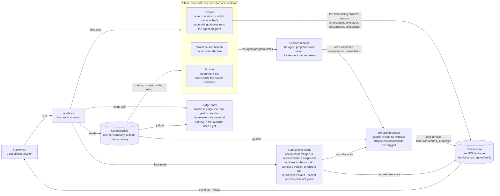
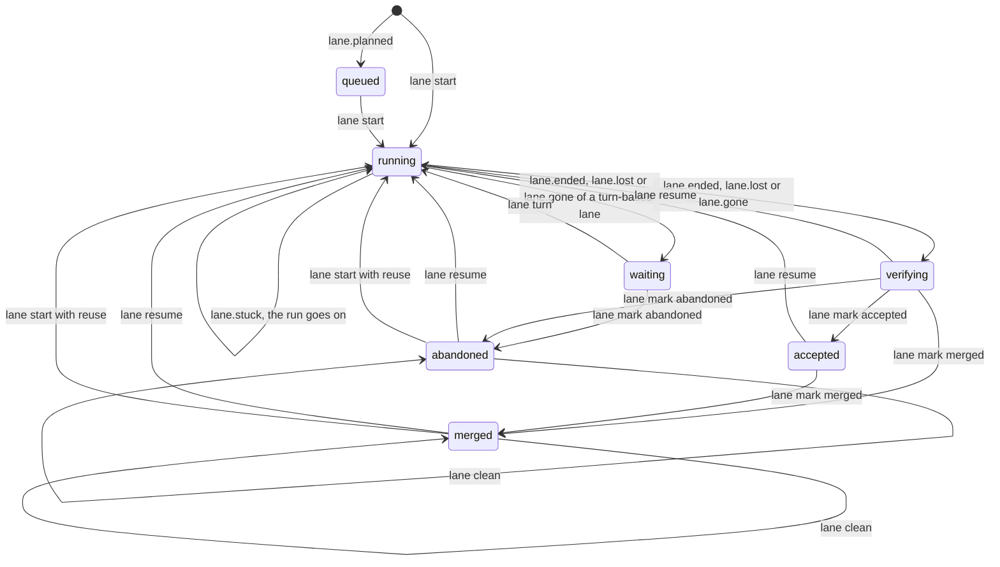
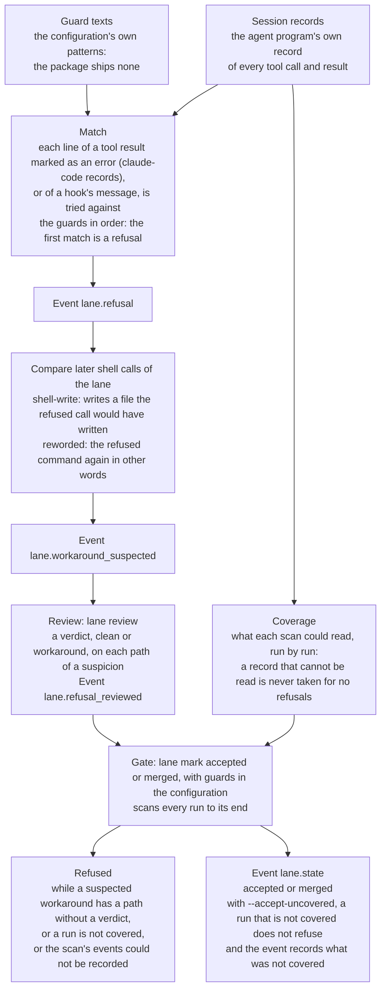
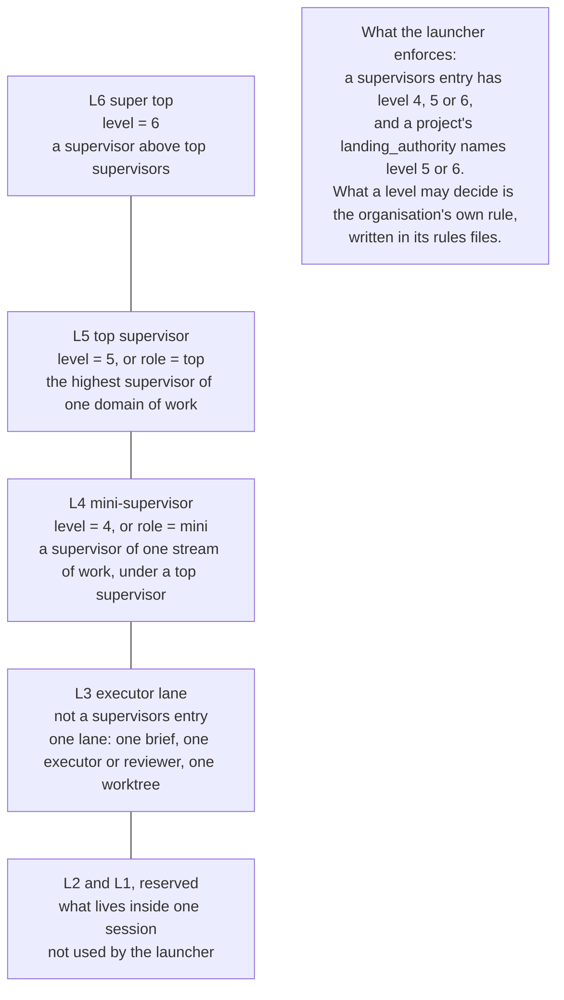

# Laneboss

**Laneboss is a launcher for supervised agent lanes: a supervisor session hands each piece of work to an executor in
its own worktree, and the launcher records what happens to it, so that the supervisor learns it from events and not
from the executor's own report.**

*Pre-release: nothing has been released and interfaces can still change. What is built is in
[What is built](#what-is-built).*

## What you get

Laneboss is for supervisor sessions, and gives every session:

- **One command**, `laneboss`: it validates configurations, records events, renders briefs, checks the environment
  and starts, watches, resumes and collects lanes (`scripts/install.sh` installs it).
- **One versioned shared protocol**, appended to every brief it renders, so that every lane is given the same rules,
  the refusal rule included. Where a configuration names its guards and a lane's raw session records, the launcher
  reads them itself for guard refusals.
- **One configuration per company**, kept outside this repository and apart from every other configuration.

Laneboss is generic: it holds no company settings, credentials or state. A configuration names the secrets it needs
and never holds one.

## How it fits together

A supervisor session plans work and hands it to mini-supervisors, executors and reviewers. A lane is one such unit of
work, with one brief, one executor and one worktree. The layers of sessions have levels, a larger number meaning a
higher level (L3 executor lane, L4 mini-supervisor, L5 top supervisor, L6 super top;
[Levels](docs/architecture.md#levels)).



The supervisor session works through the `laneboss` command, which reads the configuration and starts lanes; each
lane's supervising process records what happens to its runs as events in the event store; refusal detection reads each
lane's raw session records for guard refusals; the gate at `lane mark` (with guards in the configuration) refuses to
accept a lane while a suspected workaround has a path without a verdict, or while a run is not covered and
`--accept-uncovered` is not given; and the judge hook can ask an external command one yes/no question (nothing in the
launcher uses it yet).

## One lane, start to finish

The real output of some of the commands of the [quick start](#quick-start) below, and of `laneboss start` (the
briefing a supervisor session reads, which the quick start does not run), with `laneboss` 0.5.0 against
`examples/minimal` and the demo's home directory written `~/demo`. A line of `…` stands for lines left out; a line
that starts with `$` is a command. Between 0.5.0 and 0.6.0-dev1 the code that prints the briefing and the `lane mark`
output did not change.

```text
$ laneboss lane start --config example --project demo --lane demo-1 --brief "$demo/brief.md" --difficulty standard
…
$ laneboss event tail --config example --lane demo-1 --follow --until lane.ended
…
$ laneboss start --config example
…
## Lanes

Running (0):
Ended, waiting for the supervisor (1):
- demo-1: run 1, runner agent, model example-model-medium-1, account example-main; last end: reason exit, exit code 0, survivors 0; state verifying since 2026-10-09T22:54:14.725198Z; times: started 2026-10-09T22:54:14.480542Z, ended 2026-10-09T22:54:14.725198Z
Accepted or merged, not yet cleaned (0):
…
## Recent events

Showing the last 5 of 5 events, oldest first.
…
- seq 3, 2026-10-09T22:54:14.381968Z, lane demo-1, brief.rendered
- seq 4, 2026-10-09T22:54:14.480542Z, lane demo-1, lane.started
- seq 5, 2026-10-09T22:54:14.725198Z, lane demo-1, lane.ended
…
$ laneboss lane mark --config example --lane demo-1 --state merged
{"event": {"id": "ev-68d5b701b6a84261b4a1f3162c961a33", "seq": 6}, "kind": "lane.state", "lane": "demo-1", "scan": {"appended": {"refusals": 0, "suspicions": 0}, "not_covered": []}, "state": "merged"}
$ laneboss lane clean --config example --lane demo-1
…
$ laneboss start --config example
…
Lanes in none of these groups (queued, merged or abandoned): 1
…
- seq 6, 2026-10-09T22:54:15.482099Z, lane demo-1, lane.state
- seq 7, 2026-10-09T22:54:15.693079Z, lane demo-1, lane.cleaned
…
```

`lane start` renders the brief, picks the runner, model and account, makes the worktree and a branch named after the
lane, and returns at once; the run goes on in tmux. The supervisor then follows the lane's events, reads the briefing
(`laneboss start`, which appends nothing), records its decision with `lane mark` and cleans up with `lane clean`: the
worktree and the merged branch go, the lane's record stays.

## Install

- Linux or macOS with a POSIX `sh`, and `git` and `tmux` on `PATH` (`doctor` checks the last two). Lanes run in tmux
  sessions whose sockets are in `/tmp/laneboss-UID/`; on a system without `/proc` they also use `ps` to follow a run's
  processes.
- Python 3.11 or newer for the launcher. It needs nothing beyond the standard library (`sqlite3` and `tomllib`).
- The decision store alone also runs on Python 3.9 or newer, from a checkout; it needs SQLite 3.34 or newer with FTS5
  and its `trigram` tokenizer ([the manual](docs/decisions.md)).

With no checkout, one command installs the launcher:

```sh
curl -fsSL https://raw.githubusercontent.com/laneboss-io/laneboss/main/install.sh | sh
```

That line fetches `install.sh` from the `main` branch of the repository; [docs/install.md](docs/install.md) says what
it does and needs, and that it runs what it fetches with your rights, which nothing checks. The second way is from a
checkout:

```sh
git clone https://github.com/laneboss-io/laneboss.git laneboss
cd laneboss
sh scripts/install.sh
export PATH="$HOME/.local/bin:$PATH"
laneboss --version
```

`scripts/install.sh` installs into `~/.local` without pip, network access or administrator rights; it takes
`--prefix DIR` to install elsewhere, and `LANEBOSS_PYTHON` chooses the interpreter.

## Quick start

From a checkout of this repository, using the invented configuration in `examples/minimal`:

```sh
# 1. Install into ~/.local, without pip or administrator rights. With no checkout, one command does it (what it
#    does, needs and trusts: docs/install.md). It runs the installer of what it fetches, with your rights, and
#    nothing checks that. The command is
#      curl -fsSL https://raw.githubusercontent.com/laneboss-io/laneboss/main/install.sh | sh
#    and LANEBOSS_SOURCE names a copy on this machine to use instead of a download. From this checkout, the
#    installer that the command runs needs no network access either:
sh scripts/install.sh
export PATH="$HOME/.local/bin:$PATH"
laneboss --version

# 2. Put the example where configurations live, and validate it.
mkdir -p "$HOME/.config/laneboss/configs"
cp -R examples/minimal "$HOME/.config/laneboss/configs/example"
laneboss config validate example

# 3. doctor checks the environment. The example's runner program, example-agent, is a stand-in shipped with the
#    example: it reads the brief it is given and exits. A real configuration names an agent program instead.
cp examples/minimal/bin/example-agent "$HOME/.local/bin/example-agent"
laneboss doctor --config example

# 4. Append an event, which is always read from a file, and read the events back.
demo=$(mktemp -d)
printf '{"kind": "note.added", "actor": "me", "payload": {"text": "hello"}, "protocol_version": "1.0.0"}\n' > "$demo/event.json"
laneboss event append --config example --file "$demo/event.json"
laneboss event tail --config example

# 5. Render a brief: your text as written, then the shared protocol and the configuration's standing rules.
printf '# Say hello\n\nPrint a greeting.\n' > "$demo/brief.md"
laneboss brief render --config example --lane demo --in "$demo/brief.md" --out "$demo/brief.rendered.md"
head -n 14 "$demo/brief.rendered.md"

# 6. Start a lane. A project that names a local repository gets a worktree and a branch per lane; here the
#    project and its repository are made for the demo. lane start returns at once: the run goes on in tmux.
git init -q "$demo/repo"
git -C "$demo/repo" -c user.name=demo -c user.email=demo commit -q --allow-empty -m start
example="$HOME/.config/laneboss/configs/example"
printf 'schema_version = 1\nname = "demo"\nrepository = "%s"\n' "$demo/repo" > "$example/projects/demo.toml"
laneboss lane start --config example --project demo --lane demo-1 --brief "$demo/brief.md" --difficulty standard

# 7. Follow the lane's events until its run ends, then look at it.
laneboss event tail --config example --lane demo-1 --follow --until lane.ended
laneboss lane status --config example --lane demo-1

# 8. Record the decision, then clean up: the worktree and the merged branch go, the lane's record stays.
laneboss lane mark --config example --lane demo-1 --state merged
laneboss lane clean --config example --lane demo-1
```

Most commands print one JSON value; `doctor`, `event tail` and `judge egress` print one JSON object per line,
`laneboss start` prints Markdown unless it is given `--format json`, `org validate` prints text unless given
`--format json`, and `lane attach` prints text for a person. The configuration home is `$LANEBOSS_HOME`, by
default `~/.config/laneboss`; state goes to `$LANEBOSS_STATE_HOME`, by default `~/.local/state/laneboss`. A lane's log,
rendered briefs and kept inputs are in `STATE_DIR/lanes/LANE/`; nothing is written into a working directory given
with `--worktree` (its claim is kept in the account's one claims registry,
`~/.local/state/laneboss/.lane-claims/` of the account's own home directory, or, for a linked Git worktree, in that
worktree's own Git directory).

## An org in one folder

`laneboss org init ./research --levels 3-6` creates shared rules, level-specific protocol sources and one example
instance per level inside `.laneboss/`, alongside the org's repositories and `worktrees/`. `org instance add` adds
an agent; `org render` generates Claude imports and inlined Codex rules from the same sources, refusing hand edits
to generated files; `org validate` checks the tree, schemas, imports, secret values, hooks and owner channels. Configs
store secret names; values live in an external store. The tree and commands are in [docs/org.md](docs/org.md).

Every instance's Claude and Codex runner gets one shared PreToolUse hook, set up by `org init`, `instance add` and
`render`: rules are data in shared and level `hooks/rules.toml`, every rule has a refusal description in `refusals/`
that tells the agent why and what to do instead, and a policy or settings file that cannot be read means a denial
([docs/org-hooks.md](docs/org-hooks.md)). Only L5 and L6 instances talk to the owner, each in its own Discord channel,
registered with `org channel add`; L3 and L4 never get one ([docs/org-discord.md](docs/org-discord.md)).

Each org keeps one decision store inside its `.laneboss` home, and no command reads another org's store: a store path
or history socket that resolves outside the org is refused. Curated ledgers, reports and boards and finished lanes go
in; `org hook-history` gives a runner its own instance's or its level's past cases, ranked by time and by later
outcomes, with "do not repeat" warnings kept; `org capture-decision` stores an owner's clear decision verbatim
([docs/org-history.md](docs/org-history.md)).

## Claude through Claudock, with profile swap

Where Claude Code runs on several [Claudock](docs/claudock.md) profiles (they share one session history), a runner
names a profile in its `command`, and `integrations/claudock/profile_swap.py` (Python 3.11 or newer) moves work
between them. It reads quota from `claudock usage`, never stores a profile name, and never picks a per-token Console
API profile unless you opt in with `--include-console`:

```sh
python3 integrations/claudock/profile_swap.py pick --settings ~/.config/laneboss/profile-swap.toml
python3 integrations/claudock/profile_swap.py limited "$STATE_DIR/lanes/LANE/output.log"   # 0: a usage limit was hit
python3 integrations/claudock/profile_swap.py resume --session ID --from PROFILE -- --model MODEL
```

`resume` picks another profile with room left and continues the same session there; a limit is not a failure. The
settings file is your own (an example with invented names: `examples/claudock/profile-swap.toml`); the loop, the exit
codes and the limit messages it recognises are in [docs/claudock.md](docs/claudock.md#profile-swap).

## What is built

| Part | Built and tested | Not built yet |
|---|---|---|
| Installation | `scripts/install.sh`: no pip, network access or administrator rights; installed versions are immutable and checked against a manifest. `install.sh` at the root, for anybody without a checkout: it gets the source of one version and runs that version's own installer ([docs/install.md](docs/install.md)) | |
| Configurations | One per company, kept apart from every other (isolation by identity, not by path text); organisations; level names L3 to L6 | |
| Org template | `org init`, `instance add`, `render` and `validate`: one folder, protocol sources and generated rules, schemas and secret checks ([docs/org.md](docs/org.md)); the shared level- and identity-aware hook with refusal descriptions, `org hook`, `refusals` and `check-hooks` ([docs/org-hooks.md](docs/org-hooks.md)); L5/L6 owner channels with `org channel add` ([docs/org-discord.md](docs/org-discord.md)); one history store per org, `org hook-history` and `org capture-decision` ([docs/org-history.md](docs/org-history.md)) | `lane start` and `resume` checking an org instance's runner command; `org render` registering the history hook in runner settings; the gateway that delivers channel events and calls decision capture |
| Event store | One SQLite file per configuration: append-only, a hash on every event, duplicate-safe appends, the lane projection, `event tail --follow`, `state verify` and `rebuild` | The network service in front of the store |
| Shared protocol and briefs | Protocol 1.2.0 with its refusal rule; `brief render`, with the cost and preflight sections mandatory for briefs that touch billing or deployment | |
| Lanes | `lane start` (routing by difficulty, budgets), `resume`, `stop`, `status`, `check`, `mark` and `clean`; `lane.stuck` and `lane.timeout` events; a lane's session identity (`{session}`) and a prompt on standard input; turn-based lanes: `lane start --turns`, mail (`lane send`) and one turn at a time (`lane turn`), with the lane waiting between turns, the loop that starts those turns on a schedule (`lane loop`), and `lane attach`, a terminal view of a turn-based lane and a keyboard for it, and the runner key `stream`; `lane adopt` makes a session started outside the launcher a turn-based lane ([docs/architecture.md](docs/architecture.md#accounts-and-adoption-t5-built-in-part)) | Account choice by remaining quota; messages to a running executor |
| Refusals | Guard refusals read from a lane's raw session records, suspected workarounds, the supervisor's review, and the gate at `lane mark --state accepted` or `merged` | Telling the owner about refusals; a judge that reads suspicions; the record formats of other agent programs |
| Judges | The contract and `laneboss judge list`, `ask` and `egress`; every ask is logged, and a text the credential detector refuses is withheld before anything is sent (nothing in the launcher uses a judge yet) | The judge that picks a difficulty |
| Supervisor sessions | `laneboss start`, the briefing a supervisor session reads; the Claude Code plugin's `/laneboss` command | |
| Claudock | `cos`, an interactive front for accounts that take only headless requests, and `profile_swap.py`, quota selection and resumption of the same session on another profile ([docs/claudock.md](docs/claudock.md)); tests use stand-in wrappers and invented data. Profile swap has compile/help checks; its behavioral suite is provided for disposable-box verification | |
| Environment | `laneboss doctor`: one result line per check, and a non-zero exit when one fails | |
| Owner decisions | `laneboss decisions`: the decision store, with the owner's exact words and provenance | Binding it to a configuration |
| Publication | `scripts/scan.sh` and a pre-commit hook | |
| Whole areas | | Test machines, owner messages and cost accounting (their configuration fields are checked but not used yet) |

[Left for later lanes](docs/architecture.md#left-for-later-lanes) lists the rest. The runner block for accounts kept as
Claudock profiles in [docs/claudock.md](docs/claudock.md) is an example that no test runs.

## A lane's life



A lane's state is one of `queued`, `running`, `verifying`, `accepted`, `merged`, `abandoned` and `waiting`, and the diagram
shows the usual path only: a run that ends, is lost or is declared gone leaves the lane `verifying`, waiting for the
supervisor, except for a turn-based lane (one started with `lane start --turns`), which is `waiting` for its next turn
instead, is continued by `lane send` and `lane turn` and not by `lane resume`, and can only be marked `abandoned`; `lane mark` can record any of `verifying`, `accepted`, `merged` and `abandoned` while the lane is not
running; `lane resume` continues a lane that has run, under the conditions that [Lanes](docs/architecture.md#lanes)
lists (among them: a resume template, no process of its last run left, its claim on the working directory, a matching
session identity, and not a cleaned lane); and `lane clean` sets a flag (`cleaned`) on a merged or abandoned lane
instead of changing its state.

## How a refusal is found



A guard's pattern, written in the configuration, finds a refusal in the agent program's raw session records; later
shell calls that write the refused files or repeat the refused command are flagged as suspected workarounds; the
supervisor gives a verdict on each file; and, with guards in the configuration, `lane mark --state accepted` or
`merged` first scans every run to its end and is refused while a suspected workaround has a path without a verdict, a
run is not covered or the scan's events could not be recorded, except that `--accept-uncovered` records the decision
together with what was not covered instead of refusing for a run that is not covered (a verdict of `workaround` does
not block: the decision stays the supervisor's) ([Refusals](docs/architecture.md#refusals)).

## Levels



A `[supervisors.NAME]` entry of a configuration has `level = 4`, `5` or `6`, a larger number meaning a higher level;
level 3 is a lane and is not a `[supervisors]` entry, and levels 2 and 1 are not used
([Levels](docs/architecture.md#levels), [docs/configuration.md](docs/configuration.md)).

## The judge on five test subjects


**What was measured.** The probability that the real judge Jev (model `jev-1.13.0`, reached through the example
adapter in [examples/judges/](examples/judges/README.md)) returned, through `laneboss judge ask`, to the question
`refusal.is-refusal`: is this tool result a refusal by a guard, a hook or a permission layer of the agent program? The
judge was told to answer NO for an error of the operating system or of a test. Five subjects were each asked nine
times on 9 October 2026, between 14:57 and 20:19 UTC, in nine runs on nine different unreleased builds of the launcher
(five on 0.4.0, four on 0.5.0): 45 answers, all answered, none dropped. The subjects were written by hand for the
trial, not taken from real sessions: `hook` is a guard's block message, `harness` is the agent program's "permission …
denied" message, `os` is an operating system's "Permission denied" from `cp`, `test` is a failing test's output, and
`secret` is a line with a made-up credential, which the launcher withheld before asking. By the question's own
definition `hook` and `harness` are refusals and `os` and `test` are not, and the chart groups them in that way. The
nine runs asked identical requests, which measures how stable the answer is, not how accurate the judge is in general.
Nothing else was measured: five subjects say nothing about other results, and nothing in the launcher uses a judge yet
([docs/judges.md](docs/judges.md)). The pairs behind the chart are in
[docs/assets/data/judge_answers.csv](docs/assets/data/judge_answers.csv), and `python3 scripts/make_charts.py` draws
it from them.

## Commands

The launcher's commands that read or write state (`event`, `state`, `brief`, `doctor`, `lane`, `judge`) are bound to
one configuration, with `--config NAME` or the variable `LANEBOSS_CONFIG`; the launcher never guesses which one.
`laneboss decisions` is the exception: it is not bound to a configuration and takes its own `--db` path.
`laneboss org` also works independently, using its explicit org folder.

| Command | What it does |
|---|---|
| `laneboss --version` | Prints the program, package and protocol versions. |
| `laneboss config list`, `show NAME`, `validate NAME` or `--all`, `path NAME` | Lists, shows, validates and locates configurations. |
| `laneboss org init ORG_DIR [--levels 3-6] [--name NAME]` | Creates the org tree with generic rules and one example instance per level. |
| `laneboss org instance add ORG_DIR NAME --level N --role ROLE [--discord-channel ID] [--secret NAME]...` | Adds an instance with its own level's rules and names-only config. |
| `laneboss org render ORG_DIR` | Regenerates all org rules from protocol sources; refuses hand edits to generated files. |
| `laneboss org validate ORG_DIR [--format text\|json]` | Checks the managed org tree, schemas, imports, instance levels, secret values, hooks and owner channels. |
| `laneboss org hook --runner claude\|codex [--instance FILE]` | The PreToolUse hook: reads one event on standard input and prints the decision. |
| `laneboss org refusals ORG_DIR [--format text\|json]` | Lists every rule's refusal description. |
| `laneboss org check-hooks ORG_DIR` | Checks that every instance's runners are registered with the org hook. |
| `laneboss org channel add ORG_DIR INSTANCE (--channel-id ID \| --create) [--member ID:AUTHORITY]... [--dry-run]` | Registers an L5/L6 instance's owner channel. |
| `laneboss org hook-history --runner claude\|codex --org-dir DIR [--instance NAME]` | Prints bounded past cases for a runner's session start or prompt; prints nothing when the store is missing or locked. |
| `laneboss org capture-decision --org-dir DIR --source PTR --text-file F --author-authority decide\|inform` | Asks the org's judge whether a human message is a decision and stores a clear one verbatim. |
| `laneboss event append --config N --file F` | Appends one event read from a file (`-` reads stdin). |
| `laneboss event tail --config N [--since SEQ] [--lane L] [--follow] [--until KIND]` | Prints stored events as JSON lines; `--follow` keeps going, `--until` stops after the first event of a kind. |
| `laneboss state events`, `lanes`, `rebuild` or `verify --config N` | Reads, rebuilds and checks the event store and its lane projection. |
| `laneboss brief render --config N --lane L --in BRIEF --out RENDERED` | Appends the protocol block to a brief; `--touches billing` and `--touches deploy` require the cost and preflight sections. |
| `laneboss lane start --config N --lane L --brief FILE ...` | Renders the brief, picks the runner, model and account, makes the working directory and starts the run in the background. With `--turns [--idle SECONDS]` the lane is turn-based: it takes mail and is continued one turn at a time. |
| `laneboss lane resume`, `stop`, `status`, `check`, `mark`, `clean --config N ...` | Continues, stops, shows, checks, records decisions about and cleans up lanes. |
| `laneboss lane send --config N --lane L (--file F \| -) [--from NAME]` | Stores one message for a turn-based lane as a file of the lane and announces it with an event; the message waits for the next turn. |
| `laneboss lane turn --config N --lane L [--idle]` | Starts the next turn of a turn-based lane: a resume that carries the lane's waiting messages, or, with `--idle` and no mail, the configuration's idle message. |
| `laneboss lane attach --config N --lane L` | Shows a turn-based lane in the terminal: the live turn's output from the lane's own log, the permission mode the agent reports (with a plain warning on bypass), the cost of a turn, and `idle` between turns. A typed line becomes `lane send` and `lane turn`. It prints text for a person, starts no agent, and leaving it stops no turn; Ctrl-C stops only a turn that it started. |
| `laneboss lane scan`, `refusals`, `review --config N ...` | Scans a lane's raw session records again for guard refusals, lists refusals, suspected workarounds and what was scanned, and records the supervisor's verdict on each path of a suspicion. |
| `laneboss judge list`, `ask`, `egress --config N ...` | Lists the configured judges, asks one a yes/no question and prints its probability, and prints the log of every ask ([docs/judges.md](docs/judges.md)). |
| `laneboss doctor --config N` | Checks the configuration, its state directory, `git`, `tmux`, each runner's programs, each judge's program and the organisation's tools directory; it also warns, without failing, about a runner that can take turns and has no `limit_patterns`. |
| `laneboss start [--config N] [--role ROLE] [--format text\|json]` | Prints the briefing a supervisor session reads when it begins: configuration, protocol, standing rules with their text, role, read-only checks, lanes by group (running, ended, accepted, lost, and idle: turn-based lanes between two turns) and recent events. Without a configuration it lists them. Appends no event and creates no state (on a file system where a directory cannot be locked it may create the reader's `.lock` file, as every reader of the store does: "Known limits" in [docs/architecture.md](docs/architecture.md)). |
| `laneboss plugin path [--agent claude-code]` | Prints the directory of the installed Claude Code plugin (the `/laneboss` command) as one JSON string; not bound to a configuration. See [docs/plugin.md](docs/plugin.md). |
| `laneboss decisions ARGS` | The owner decision store; the same as `python -m laneboss.decisions ARGS`. |

A supervisor learns about every change of a lane from its events: `event tail --follow` shows `lane.started`,
`lane.stuck`, `lane.timeout` and `lane.ended` as they happen ([Lanes](docs/architecture.md#lanes)). With guards in
the configuration, it also shows `lane.refusal` when a guard refuses an action in the lane, read from the agent
program's own session records rather than from the executor's report, and `lane.workaround_suspected` when the lane
then writes the refused files through the shell or sends the refused command again in other words; `lane mark --state
accepted` or `merged` is then refused while a suspected workaround has a file without a verdict, or while a run is not
covered and `--accept-uncovered` is not given (with it, the decision is recorded together with what was not covered)
([Refusals](docs/architecture.md#refusals)). When a lane
command cannot see what it needs (the process table, a signal's effect, Git's answer), it says so and does nothing
it cannot verify: `lane check` never records a run as lost without seeing its supervising process gone, and
`lane stop` names every process that survives.

Exit codes of the launcher's own commands: `0` success, `1` a `doctor` check failed (or, for `judge ask`, the judge
gave no answer), `2` invalid input, a refused request or a lane command that could not be carried out, `3` an
integrity problem, `7` (for `judge ask`) the ask could not be logged: either nothing was asked, or the judge ran and
its answer could not be logged, `70` an unexpected internal error ([docs/judges.md](docs/judges.md)).
`laneboss decisions` passes through the decision store's exit codes, which add `4` (embedding provider), `5` (database
busy), `6` (permission problem) and `7` (storage problem); they are listed under [Run](docs/decisions.md#run) in its
manual.

## Documents

- [site/index.html](site/index.html): one page for somebody who has never seen the project; open it in a browser.
- [docs/architecture.md](docs/architecture.md): how the launcher works: installation, isolation between
  configurations, the event store, lanes and their events, refusals and suspected workarounds, briefs, `doctor`,
  the publication scan and the known limits.
- [docs/configuration.md](docs/configuration.md): every field of a configuration.
- [docs/org.md](docs/org.md): an org in one folder, its files, schemas, commands, runner rules and external secrets.
- [docs/org-hooks.md](docs/org-hooks.md): the org hook, its rule data and refusal descriptions.
- [docs/org-discord.md](docs/org-discord.md): L5/L6 owner channels and channel-aware events.
- [docs/org-history.md](docs/org-history.md): the org's history store, ranking, injection and decision capture.
- [docs/install.md](docs/install.md): the one-command install: what it does, needs and trusts, and where the source
  comes from.
- [docs/judges.md](docs/judges.md): the judge contract, the three `judge` commands and the egress log.
- [docs/decisions.md](docs/decisions.md): the owner decision store.
- [docs/plugin.md](docs/plugin.md): the Claude Code plugin: its one command, how it handles arguments, and the
  steps to add it to Claude Code.
- [docs/claudock.md](docs/claudock.md): Laneboss with Claudock: a runner for accounts kept as Claudock profiles, and
  `cos`, an interactive front for accounts that take only headless requests, plus quota-aware profile swaps
  that resume the same session.
- [src/laneboss/protocol/protocol.md](src/laneboss/protocol/protocol.md): the shared protocol.
- [examples/minimal/](examples/minimal/): the example configuration used above.
- [CONTRIBUTING.md](CONTRIBUTING.md): running the tests, the publication scan, commit rules and the refusal
  rule.
- [CHANGELOG.md](CHANGELOG.md): what has changed.

Works with Claudock: [docs/claudock.md](docs/claudock.md) shows one runner that starts the agent program under the
account of a Claudock profile, `cos`, a small terminal front for accounts that take only headless requests,
and `profile_swap.py`, which moves an existing session to a profile with room left. Laneboss does not need Claudock.

## Status

**Pre-release.** Nothing has been released, and interfaces and file formats can still change. What is built and tested
is in [What is built](#what-is-built); the right-hand column there is not built yet.

License: Apache License 2.0; see [LICENSE](LICENSE) and [NOTICE](NOTICE).
