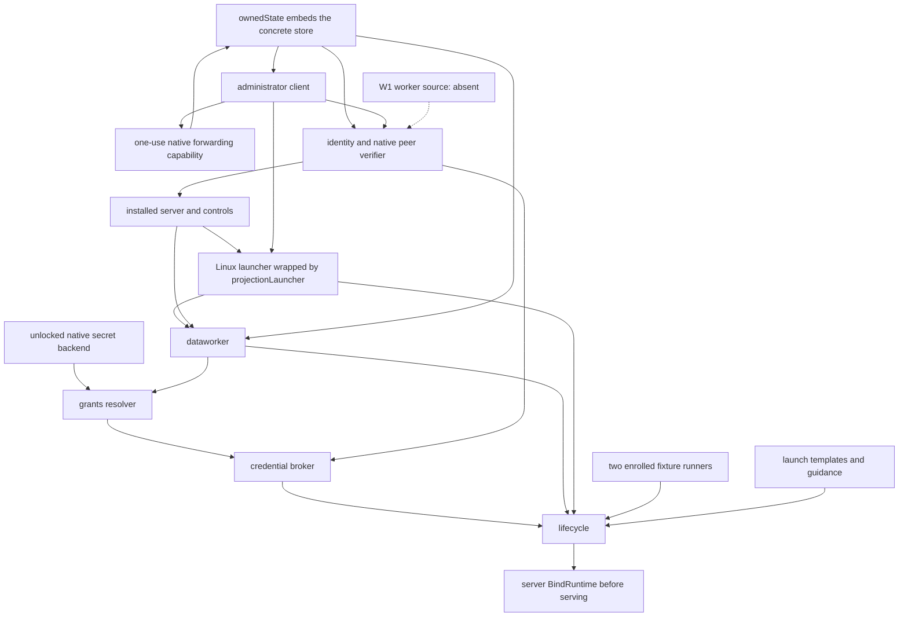

# Installed lifecycle: remaining construction gaps, round 3

Source baseline: `3c855c54`, as named by the brief. This is a source trace of
the installed **lifecycle** suite, including its failure/recovery branches. It
is not an installed E2E pass or a claim that another lane's pending changes
have landed. No other working copy or Git metadata was inspected.

The brief calls `lane.claudock.start` step 42. The retained READ-AHEAD tables
number it 44, followed by Codex start 68 and cleanup 78. The current literal
catalog in `scripts/v2-serve/lifecycle.py:25` also includes the preceding human
ceremonies. Method/row names below are the authoritative selectors; historical
numeric row labels must not identify a different operation.

Unless a path begins with `scripts/`, `cmd/` or `e2e/`, component paths below
are relative to `internal/v2/`; bare assembly filenames are in `assembly/`.

## Result and ownership

The 283 non-test `NotImplemented(` source lines outside `internal/v2/api` are
an inventory, not 283 installed blockers. Most are guards whose concrete ports
are present, platform alternatives, or operations this suite never requests.

Count by **work item**, with all related refusal sites listed below:

| Size | Items | Current disposition |
| --- | --- | --- |
| S | 1 | Archive native forwarding/wiring fixed in this round. |
| M | 2 | Archive-kind identity handoff validation and the normal ended-lane release stage need routing. |
| L | 5 | Worker source and credential projection already owned; failed-plan cleanup consumption, native Git/workspace enrollment and authenticated capture drain need routing. Failed-plan consumption is a failure-branch item. |

Eight work items were found; seven remain after the small fix: M2/L5. The current
stop/check/archive sequence does not execute a native agent release. Clean
nevertheless requires its committed measured release receipt (R2). Building
that missing stage must also solve R1's capture-drain barrier. Failed-start
cleanup first needs its missing consumer/completion bridge (F1), which would
also need R1 when a capture producer exists. Neither route is claimed to run
through `captureJobs` in the baseline's successful Stop branch. The normal
start-to-clean dependency set is S1/M2/L4; F1 adds a separate failure-branch L1.

| ID | First relevant step | Missing piece | Size | Owner/status |
| --- | --- | --- | --- | --- |
| W1 | `lane.claudock.start`; repeated at `lane.codex.start` | Protected `WorkerLaunchSource` for materialization's committed native input, endpoint, peer and helper guard. | L | **serve2 run 50**, already owned; not edited here. |
| C1 | Agent preparation/open during start; fencing and withdrawal during stop/recovery | Durable credential projection store operations and the actual assembly credential sources/validators. | L | **serve2b round 13**, already owned; not edited here. |
| F1 | Failed start after a credential slot is selected; before native recovery work | Retained `PlanCleanup` rows have no installed executor, claim/completion protocol or terminal acknowledgement writer. | L | Unowned; route service/store failed-plan cleanup, coordinated with credential owner. Failure branch only. |
| R1 | Native recovery after F1 dispatch is built; also the measured normal release required by R2 | Authenticated service acknowledgement of the actual outside capture ranges and EOF, with a measured native job discharge. | L | Unowned; route capture/helper/service work. A downstream native barrier, not a claim that pending rows already execute. |
| A1 | `lane.claudock.archive`; repeated for Codex | Store's native archive freeze/read-back capability was omitted from assembly. | S | **Fixed here**, using the already constructed real administrator client. |
| A2 | Archive worker opening, after A1 and W1 | Identity's fixed worker handoff validator supports `materialize` only; it has no archive-specific validation branch. | M | Unowned follow-on; coordinate with run 50, whose assigned source alone does not implement this validator. |
| G1 | `lane.claudock.clean`; repeated for Codex | Actual Git/worktree creation and protected workspace-native enrollment for the dynamically allocated workspace ID. | L | Unowned; route native workspace/materialization/cleanup ownership. |
| R2 | Clean, after protected workspace resolution; repeated for Codex | No normal ended-lane `HelperRelease` effect is created, although cleanup requires its committed measured receipt. | M | Unowned; route lifecycle/service release-stage orchestration, coordinated with R1. |

S means existing typed ports need a bounded forwarding/wiring correction.
M means a bounded missing protocol/function branch with security validation.
L means a native/durable ownership bridge or producer spanning several owners.
Removing a guard, filling an availability constant, or manufacturing a receipt
does not reduce an item's size.

## Installed build selection and dependency graph

`scripts/v2-serve/run.py:810` selects, and line 811 builds, the installed binary with
`laneboss_partial,laneboss_e2e_authenticator`. It installs those exact bytes,
then starts the helper and service units. Assembly enters through
`Build`/`Serve` in `internal/v2/assembly/assembly.go:38` and Linux selects
`platform_linux.go`. The backend is `linux-bwrap-landlock`.

With these two tags and the harness's protected fixture enrollment,
`runners_partial.go:16` selects `enrolledFixtureRunner` for both drivers and
`profiles_partial.go:23` supplies the initial profile planner. The untagged
`runners_release.go` selects real adapters instead; that is a different
runtime graph. The fixture changes vendor execution only, not service,
identity, state-store, helper, confinement or cleanup authority.



The native cycle is broken by a forwarding object created before `store.New`
and bound once to the actual `admin.Service` at `assembly.go:100`, before the
server is published. This round supplies that same object as `ArchiveNative`
as well as `CleanupNative` at `assembly.go:77`.

| Constructed component | Actual supplied dependencies | Nil, zero or stubbed in this graph; relevance |
| --- | --- | --- |
| `store.Service`, `assembly.go:77`; `ownedState`, `resources.go:23` | Config, state directory, enrollment, wall clock, late-bound cleanup and now archive native capability. `ownedState` embeds `*store.Service`, preserving its private interfaces. | Credential projection methods are unconditional stubs (C1). Archive limits are zero installation overrides with implemented budget-derived defaults, not missing limits (`store/arch_limits.go:27`). |
| `admin.Service`, `assembly.go:94` | Concrete state, service UID, config, artifact, runtime and launch enrollment, version/protocol/schema. Isolation probe is bound to the real wrapped launcher. | No absent store/helper client port for the traced calls. Empty `BindingFile` uses the named protected installation. Protected workspace-native records have no producer on this path (G1). |
| `identity.Service`, `assembly.go:111` | Native peer verifier, administrator registry, concrete state, clock; `Sessions` resolves through the concrete store. Connections are bound to the server at line 124. | **Workers=nil** (W1). Zero attestation configuration is frozen by the normal trust-policy constructor; it is not an absent validator. |
| `service.Service` and `service.Server`, lines 115/120 | Installed binding, concrete state, identities as authenticator/enrollment validator, clock, helper isolation evidence. | All listed dependencies supplied. Server runtime is attached before `ServeInstalled`; dynamic type guards for store ports are satisfied by the embedded concrete store. A dispatchable `HelperRelease` handler exists, but no normal ended-lane owner creates its effect (R2). The reconciler also has no consumer/completion bridge for the separate failed-plan outbox (F1). |
| Linux isolation, `platform_linux.go:20` | Helper, pinned runtime manifest, server as launch control source. | `Controls` is supplied. Darwin/other native refusals are excluded by platform and selected backend. |
| `projectionLauncher`, `assembly.go:134`, `projection.go:23` | Linux launcher, helper binder; runtime credentials and projection identity installed by `bindRuntime`. | Temporary nil fields exist during construction only. The configured/binder/credentials/identity guard at `projection.go:52` is satisfied after binding. Native credential source construction remains C1. |
| `dataworker.Service`, line 139 | Config, server materialization controls, wrapped launcher, concrete state, helper, clock. | `Workspace=nil` is resolved from `Helper.(api.WorkspaceCollector)` in `dataworker/cleanup.go:47`. Legacy generic materialize/test/render/archive and channel/publication methods remain stubs, but the suite uses `MaterializeLaunch`, fixed internal archive and `CollectCleanup`. |
| `secrets/native.Service`, `resources.go:49` | Protected encrypted record directory, key handle, clock, config; actual installed key unlocked through the protected provisioning path. | No nil backend. Profile/source data and selected mode validators must come from C1, not invented material. |
| `grants.Service`, line 149 | Config, identities as human verifier, concrete state, dataworker, clock, native backend as profile enrollment reader. | No absent constructor dependency. Broker-volume and child-test/revocation stubs are outside this snapshot-copy/start/stop/abandon sequence. |
| `secrets.Service`, line 153 | Native backend, state, config, grants, identities, clock, helper, server controls/bootstrap, identities as projection identity. | `ServiceScope` is derived by `secrets.New` at `secrets/service.go:75`. `UsageJobs`, `CodexValidator`, `HeadlessValidator` are nil. The actual fixture profiles use `helper` mode, so neither vendor validator is called. Initial profile evidence records no authenticated room and its material source is absent (C1). Usage jobs are not requested by the lifecycle fixture. |
| `judge.Service` and both installed provider adapters, lines 162/`judges.go:25` | Concrete state/clock and two lazy provider resolvers with protected deployment pins. | Raw provider adapters omit live worker accounting/credential capabilities; scoped dispatch has an egress-lease stub. The fixture performs no inference. Provider dispatch is not silently enabled by this graph. |
| `policy.Service`, line 171 | State, scoped judge, clock, configured command deadline, closure to the eventual templates source validator. | `MaxCostMicros=0`; fresh inference refuses at `policy/evaluate.go:202`. Source validation closure is bound before service exposure. This suite uses approved policy reads, not `policy.evaluate`. |
| `guidance.Service`, line 181 | State, scoped judge, clock. | No nil dependency. Reservation-bound launch guidance is implemented. The harness's zero-spend selection does not request a model; binding/empty/unavailable results are retained by the real writer. |
| `templates.Service`, line 185 | State, policy, dataworker publisher, clock. | `Human=nil`, bootstrap renderer/ownership pins zero. These affect public bootstrap, not `LaunchBriefing`; its private `LaunchBriefingReader` is implemented by the state store. |
| Two fixture runners, line 189 | Protected runtime enrollment and selected driver. | Start has a real input validation/plan implementation. Resume, turn and capture-to-session/limit methods remain explicit stubs (`runners_partial.go:96-109`); the lifecycle suite never calls them. |
| `lifecycle.Service`, line 195 | State, identities, server dispatch, grants, launcher, helper sources/capture, both fixture runners, credentials, guidance, templates, core blobs, worker/review, clock. | CredentialIdentity derives from Identity; ReviewControl derives from Store in `lifecycle.New:76`. Archives derives from Store at `lifecycle/archive.go:41`. Delivery, Input and Collector are nil. Delivery/Input are unused by fresh starts with no mail/input; legacy `CollectLane` is not the installed Clean effect path. Failed plans retain private requests, without an installed execution/completion owner (F1). |
| `watchdog.Service`, line 201 | Config, fixture Claudock runner, grants, state, credentials, lifecycle, launcher, clock; bound to lifecycle at line 209. | `ResolveUsage=nil`; usage continuation would refuse at `watchdog/usage.go:60`. No quota/swap signal is generated by these fixtures or requested by the harness. |
| `messaging.Service`, line 212 | State, clock, launcher, credentials, dataworker channel port. | Optional Authenticator/Grants/Human adapters are nil; production resolution uses connection/store authority. Channel worker implementation is stubbed and not requested here. Runtime MailDelivery is supplied, while lifecycle's separate Delivery field remains nil. |
| `approval.Service`, line 216 | State, identities, worker, publisher, clock. | No nil constructor port. Worker change publication is stubbed; no org-change operation appears after the start step. |
| `dashboard.Service`, line 220 | State, identities as Human, lifecycle, messaging, approval. | Transport and Clock are nil; Identity/Authenticator derive from Human, time has a real clock fallback. Browser transport is not the CLI lane-status route. |
| `records.Service`, line 224 | State, dataworker, clock. | RecordWorker and ResourceWorker are nil; external/owner-sheet intake stubs also remain. The lifecycle fixture calls only `identity.self`; the separate state suite has different coverage. |
| `migration.Service`, line 228 | State, identities, dataworker. | No nil constructor dependency. Migration is not requested in these rows. |
| `distribution.Service`, line 232 | State, identities, helper, server dispatch control, helper installer, migration. | No nil constructor port. Deployment/upgrade methods and measured dispatch drain remain incomplete; systemd shutdown does not call deployment drain. |
| Final runtime, lines 240-244 | Every field in `api.RuntimeServices` is supplied, including credentials/identity, publisher, delivery, deployment, intake, planners, worker and all registered modules. | Non-nil objects can still contain the stubs listed above. Binding an object is not proof that every operation it advertises is built. |

## Reachable missing/refusal sites

For `api.NotImplemented`, the quoted message below includes the factory's
` is not implemented` suffix. Related sites share the work-item ID and size;
they are not extra counts. A1 describes the pre-fix baseline and is no longer
an unsatisfied dependency after this round's wiring.

| Item | Step and source location | Exact message / absence | What must be supplied |
| --- | --- | --- | --- |
| W1, L, owned run 50 | Start materialization: `service/materialization.go` calls identity `BindLaunch`; `identity/worker_bind.go:43`; omitted field at `assembly/assembly.go:111`. | `retained fixed worker descriptor and native lease handoff is not implemented` | Protected native worker source/guard spanning helper ownership, actual descriptors/peer and durable worker binding. A caller's serialized principal is not a replacement. |
| C1, L, owned serve2b round 13 | Start credential acquisition: `lifecycle/plan_runner.go:228` -> `secrets/credential_slots.go:71`; initial evidence producer at `admin/initial_profiles.go:59`. | `selected enrolled profile has no authenticated room` (`unavailable`) | The initial producer deliberately records `Available: false`, reflecting the absence of credentials. Assembly credential-source work must supply permitted material and actual source/room evidence. Changing that field to a success constant is not a fix. |
| C1 | After actual room evidence exists: `secrets/credential_slots.go:193` -> `secrets/native/broker.go:222` -> `secrets/private/files.go:97`; missing source is declared at `assembly/profiles_partial.go:56`. | `encrypted secret record is absent` (`not_found`) | A real protected source matching the issued grant. The initial planner declares an unavailable source; it does not store credential material. This gate follows the no-room gate rather than firing simultaneously. |
| C1, L, owned serve2b round 13 | Start/open and recovery: `store/credential_stubs.go:17`. | `store.CredentialProjection is not implemented` | Actual lookup and validation of the retained projection keyed by config/prepared gate. |
| C1 | Native preparation: `secrets/projection.go:362` to `store/credential_stubs.go:21`. | `store.ReserveCredentialProjection is not implemented` | Atomic authenticated projection reservation. |
| C1 | Native acknowledgement: `secrets/projection.go:563` to `store/credential_stubs.go:25`. | `store.CommitCredentialProjection is not implemented` | Exact helper receipt commit/read-back. |
| C1 | Stop/failure withdrawal: `secrets/projection.go:642` to `store/credential_stubs.go:29`. | `store.FenceCredentialProjection is not implemented` | Durable generation/fence transition with original cause. |
| C1 | Withdrawal completion: `store/credential_stubs.go:33`. | `store.CompleteCredentialWithdrawal is not implemented` | Measured helper/broker completion and immutable read-back. |
| F1, L, unowned, failure branch | `lifecycle/plan_fail.go:71` -> `store/plan_cleanup.go:326` saves pending requests; `store/plan_cleanup.go:357` exposes `PendingPlanCleanup`, with no production caller outside that store file. `service/reconcile.go:36` consumes only ordinary `PendingEffects`. | No direct `NotImplemented` error exists here: requests remain `State: "pending"`, generation 1. The private outbox reader/validator is built; consumption and a durable terminal acknowledgement are absent. | An installed cleanup owner that claims/reconciles the original selector, executes withdrawal/release/revoke-injection under correct authority, and commits measured completion without replaying or discarding unknown work. Presence in dispatch-stop target inventory is not execution. |
| R1, L, unowned | Native release/collection once R2's normal stage or F1's failure consumer is supplied: `admin/resources_linux.go:80` or `admin/collection_linux.go:559`, then `admin/collection_linux.go:541`. | `capture spool and EOF have no authenticated service drain acknowledgement` (`containment_unknown`); after archive retention closes the live producer, the earlier guard can instead report `capture job ownership was lost; retained spool cannot be discarded` at line 534. | Authenticated capture ingestion/acknowledgement and a durable discharge measured against the actual producer/pipe/EOF inventory. A local spool or a zero-length log does not prove a service acknowledgement. |
| A1, S, fixed | Archive reservation: `store/archive.go:110`. | `protected current workspace/history/capture freeze is not implemented` | The real `archive.Native` capability; now supplied by the one-use helper forwarding object. |
| A1 | Archive retry/freezing: `store/archive.go:294`. | `protected archive freeze reconciliation is not implemented` | Same bound native capability, preserving the original intent. |
| A1 | Archive completion/read-back: `store/arch_result.go:242`. | `protected archive freeze recheck is not implemented` | Forwarded `CheckArchiveFreeze`; never a true/no-op result. |
| A2, M, unowned | Archive worker: `service/archive.go:135` calls `Identity.BindLaunch`; `identity/worker_bind.go:137-138`. | `fixed launch handoff for this worker kind is not implemented` | An archive-specific fixed-handoff validator. The existing branch checks `materialize` argv/input class and associated fields, so merely allowing another kind string is unsafe. Store worker lookup and `dataworker.RunInternal` already have archive branches. |
| G1, L, unowned | Clean: `service/archive.go:201` -> `store/collection.go:124` native workspace resolution -> `admin/clean_linux.go:38` -> `admin/files_linux.go:46`. Harness independently requires the same record at `run.py:279`. | `installed helper path is missing or unreadable` (`prerequisite`) for the protected workspace-native registry input. The pointer port itself is now bound. | A producer for the actual dynamically allocated workspace, Git repository/worktree/branch, pinned Git executable and exact native inode/enrollment record. The materialization path currently copies an immutable tree into private directories; it does not produce this Git registration. |
| R2, M, unowned | Clean after G1: `store/collection.go:167` queries the agent's completed release effect. Successful Stop at `service/reconcile.go:233` records only Observation; `lifecycle/control.go:195` records end/state; `lifecycle/review.go:265` records the decision; archive freezes and retires its separate worker. | The release query returns `sql.ErrNoRows` (`sql: no rows in result set`) when there is no completed release; malformed rows would hit `cleanup lacks the committed measured helper release` at `store/collection.go:175`. This is a missing stage/producer, not a nil interface. | Create and reconcile an exact retained `HelperRelease` stage for the ended agent, then commit the actual measured receipt before cleanup. `service/launch_control.go:403`/`store/launch_control.go:188` only find an existing release effect; they do not create one. The archive worker's retirement receipt cannot substitute for the agent's lease. Coordinate with R1; merely inserting a receipt bypasses the missing measurement. |

The W1 and C1 gates can be encountered during different stages of the same
start operation, including native prebinding, materialization and agent open.
Their exact first runtime refusal depends on how the already-owned changes
land. The graph does not count a completed launch claim as fresh authority.

For G1, the bounded production-source search covered `internal/v2/admin`,
`internal/v2/dataworker`, `scripts/v2-admin`, and `scripts/v2-serve` for the
workspace schema, registry path, `workspaces` and cleanup-workspace creation.
It found the registry reader and harness read-back. The writer/Git constructor
is in `admin/clean_fixture_test.go`, which is a component fixture, not installed
production wiring. Fixture creation in a test is not a built runtime producer.
The supplied project object in `scripts/v2-serve/bundle/main.go:123` is a tree
with a README; no enrolled native Git namespace is supplied there.

For R2, the production-source search covered `internal/v2` for `HelperRelease`
construction, release calls, `Outcome.Release`, and native collection callers,
excluding tests/testfx. The Linux launcher's `Collect` implementation at
`isolation/linux/service.go:404` requires an already retained release stage.
No successful stop/check/mark/archive row calls it or creates that stage. Clean
does not create it either: `BeginCleanup` first resolves G1, then reads the
missing completed release. Existing failed-plan cleanup records and archive
worker retirement are different owners/leases. This is source-traced absence,
not an observed installed E2E error.

For F1, the production search of `internal/v2` found the pending reader, storage
and verification paths, and dispatch-stop target inventory. It found no cleanup
consumer or completion writer. `api/plan_cleanup.go:8` explicitly distinguishes
the durable request from a release/quiescence receipt, and
`store/plan_cleanup.go:64` says it executes/acknowledges no cleanup. Therefore
the failure table must stop at F1 before attributing a native R1 refusal to an
actually executed failure consumer. These additional producer/consumer gaps
(F1/R2) are listed even though they have no `NotImplemented(` call site.

## Step-by-step calls after start

Both drivers use the same service/helper graph. Rows below name the literal
harness check, so the numeric drift in the older READ-AHEAD files cannot hide
a different request.

| Harness row, in catalog order | Actual route | New/unresolved construction gap |
| --- | --- | --- |
| `lane.claudock.start` (brief step 42) | `scripts/v2-serve/lifecycle.py:216` -> CLI `lane.start` -> mutation reservation -> `lifecycle.PlanLaunch` -> reserved inputs/helper allocation -> `MaterializeLaunch` -> actual fixed worker -> credential slot and fixture `Start` plan -> native capture/spec/prepare -> committed identity -> credential projection/open. | W1/C1. Runtime projection, lane endpoint composition, prompt stdin and native storage/worker-root readers exist in this tree. |
| `lane.claudock.running` | `scripts/v2-serve/lifecycle.py:103` status plus signed `lane.check` -> `lifecycle/control.go:162` -> Linux Observe -> `service/launch_control.go:294` -> `ProcessObservationAuthority` -> helper ObserveGate. The fixture also runs the actual inherited CLI's `identity.self` (`cmd/laneboss/serve-fixture/main.go:230`). | No extra nil port. The older B1 completed-claim barrier is superseded by implemented read-only monitoring authority. |
| `lane.claudock.events` | `scripts/v2-serve/lifecycle.py:86` -> `event.tail` with `follow=false` -> lifecycle reader -> concrete store pages; exact created/bound/started events checked. | No additional reachable stub. No streaming producer or content-search operation is requested. |
| `lane.claudock.reason` | `scripts/v2-serve/lifecycle.py:121` -> retained task-class blob via begin/chunk/commit. | Core blob service, authenticated state writer and clock are supplied. |
| `lane.claudock.stop` | `scripts/v2-serve/lifecycle.py:127` -> signed `lane.stop` -> committed Stop effect -> `service/reconcile.go:233` -> native Observe/Stop -> helper `admin/gate.go:350` credential withdrawal -> actual measured observation. | C1's fence/completion ports and actual sources. No synthetic exit or alternate kill route is supplied. |
| `lane.claudock.quiescent` | `scripts/v2-serve/lifecycle.py:133` -> repeated signed checks -> real terminal state/survivors -> committed observed/end events. | No additional nil-dependency guard after C1. The real cgroup/UID/reference observations can still refuse; this source trace is not a runtime pass. |
| `lane.claudock.abandon` | `scripts/v2-serve/lifecycle.py:158` -> exact empty review, state `abandoned` -> `lifecycle/review.go:265`. | Positive-review verification stubs are not reached: `LaneMark` calls those only for accepted/merged, not this abandonment. |
| `lane.claudock.archive` | `scripts/v2-serve/lifecycle.py:164` -> `lifecycle/archive.go:9` -> concrete store ArchiveControl -> native freeze -> committed archive job -> `service/archive.go:33` -> real worker gate/identity -> authenticated parts/result -> retirement and store read-back. | A1 fixed; W1 then A2 still matter to the archive worker. The generic `DataWorker.Archive` stub is not called. |
| `lane.claudock.clean` | `scripts/v2-serve/lifecycle.py:173` -> Clean effect -> `service/archive.go:190` -> store BeginCleanup/inventory -> `DataWorker.CollectCleanup` -> helper WorkspaceCollector -> store native/immutable read-backs and completion. | G1, then R2's missing completed agent release. Its implementation also needs R1. The old B2 nil-cleanup-port claim is no longer current. The legacy lifecycle `OwnedCollector` fallback is not this installed effect route. |
| `lane.claudock.collected` | Status plus events and independently read helper/Git namespaces via `scripts/v2-serve/run.py:268`. | Depends on actual G1 completion; readers add no new unimplemented port. |
| `human.codex.session.challenge` | `scripts/v2-serve/human.py:85` -> `human.challenge` for the exact session intent. | No missing port; identity and the concrete store are bound. |
| `human.codex.session.confirm` | `scripts/v2-serve/human.py:101` -> `human.confirm` with the real test-device signature/counter. | No missing port; simulated provenance remains required. |
| `human.codex.grants.challenge` | Same challenge route, for `grants.root` and the exact root manifest. | No additional construction gap. |
| `human.codex.grants.confirm` | Same confirmation route for that manifest digest. | No additional construction gap. |
| `human.codex.ticket.challenge` | Same challenge route for the separate driver/L5 ticket. | No additional construction gap. |
| `human.codex.ticket.confirm` | Same confirmation route, bound to current grant generation. | No additional construction gap. |
| `human.codex.read.challenge` | Same challenge route for a fresh `human.session` prelude. | No additional construction gap. |
| `human.codex.read.confirm` | Same confirmation route; the following CLI binds the proof on its own socket. | No additional construction gap. |
| `human.codex.control.challenge` | Same challenge route for exact method/target/current lane generation. | No additional construction gap. |
| `human.codex.control.confirm` | Same confirmation route; read-session authority cannot replace a control proof. | No additional construction gap. |
| `human.codex.session` | `scripts/v2-serve/human.py:109` -> `human.session`, then actual same-socket `identity.self` read-back. | No new nil port or invented lane containment lookup for a human peer. |
| `human.codex.grants` | `scripts/v2-serve/human.py:166` -> `grants.root` -> current manifest/native profile metadata. | No new port beyond C1's already-owned source/profile work. |
| `human.codex.ticket` | `scripts/v2-serve/human.py:177` -> `ticket.issue`, separately issued for Codex/L5. | No additional construction gap; the service issues the one-use ID. |
| `lane.codex.inputs` | Protected initial selectors and issued grant IDs validated by the harness. | Input validation only; no new native port. |
| `lane.codex.start` | Same start route, using the separately enrolled Codex fixture and its own issued ticket/life/run. | W1/C1 recur; first lane collection is a prerequisite to second-driver pool use. |
| `lane.codex.running` | Same status/signed check and fixture `identity.self` route. | No new port beyond successful W1/C1 completion. |
| `lane.codex.events` | Same exact-life/run non-follow event pagination. | No additional reachable stub. |
| `lane.codex.reason` | Same task-class blob upload/commit route. | No additional reachable stub. |
| `lane.codex.stop` | Same committed stop, native wait and credential withdrawal route. | C1 fence/completion recur. |
| `lane.codex.quiescent` | Same repeated signed native terminal/zero-survivor check. | No additional missing dependency. |
| `lane.codex.abandon` | Same exact empty review and abandoned-state mutation. | No positive-review verifier is requested. |
| `lane.codex.archive` | Same native freeze, fixed archive worker and verified read-back route. | A1 fixed; W1/A2 recur. |
| `lane.codex.clean` | Same store inventory, actual native Git/workspace collector and independent read-back. | G1/R2 recur; the required measured release also depends on R1. |
| `lane.codex.collected` | Same cleaned status, event and native namespace evidence. | Depends on actual G1 completion; no new missing port. |
| `cleanup` | `scripts/v2-serve/run.py:1106` -> stop-owned checks -> capture journals -> stop named units -> require MainPID/status/socket results -> `assembly.Serve` requested cancellation -> `service/host.go:200` actual listener/connection/job drain -> owned store/backend close. | No new NotImplemented call on successful shutdown. Deployment `DrainDispatch` is a different operation. A failed prior gate remains failed and retained. |
| Failed start / release recovery | Planner failure journal -> retained cleanup outbox. The installed consumer/completion bridge is missing (F1); native execution after that bridge would reach R1 when a capture attempt exists. | F1, then R1. The successful Stop branch records an observation and the normal archive path verifies native spool EOF; neither creates R2's release stage or a service capture-drain acknowledgement. |

## Why the other explicit stubs are not next-step blockers here

These exclusions depend on concrete tags, objects, supplied fixture inputs or
the exact called method. They are not permission to ignore a runtime refusal.

| Sites / family | Reason excluded from the listed happy-path blocker set |
| --- | --- |
| `assembly/registration_partial.go:20,24`; `service/server.go:469,476`; stream guard | Real module registration supplies the lifecycle/blob/identity/grants handlers; `TestDraftFourRealRegistrations` checks registrations directly rather than crediting partial fallback. An omitted owner would still refuse. Event reads use the implemented non-follow path. |
| Linux isolation control guard, `isolation/linux/service.go:55` | `Controls=server` is passed at construction. It is not a nil stand-in. |
| `admin/gate_linux.go:523,537` | The installed runtime has no generic `RuntimeManifest.Bindings`; lane endpoint mounts use their implemented dedicated composition. Fixed materialization and archive jobs call `startDataGate` (`admin/worker_linux.go:119`) and `startArchiveGate` (`admin/arch_gate_linux.go:32`), not the generic worker branch in `startConfinedGate`. W1 is the separate identity-side native handoff source. |
| `admin/launch_capture.go:212`; `lifecycle/supervisor.go:80` | The first creates the explicit unsupported-enrollment fallback, which is overwritten with the original unsupported refusal before return. This harness enrolls the actual release as outside supervisor (`scripts/v2-serve/bundle/main.go:138`), so registration uses implemented `registerNativeCapture`/`capture-spool`. It does not invoke the distinct `internal supervisor` bootstrap whose clock/ingress guard is at line 80. R1 tracks the still-missing authenticated service drain acknowledgement. |
| Lifecycle nil runner / source / capture / template / guidance / blob / grant guards | Assembly supplies concrete owners; helpers expose the required source/storage/capture interfaces, templates uses the implemented launch reader, and state embedding preserves the private writer ports. |
| `service/materialization.go:53`, `dataworker/materialization_stage.go:19` | Runtime Helper is the real administrator; Controls is the actual bound server. Linux `dataworker/internal.go` and `internal_linux.go` implement the projected-root bridge. Older missing-bridge statements are stale. |
| `service/archive.go:36,42,46,49,193,199`; `service/host.go:279,286,290`; cleanup readback guards | Concrete state, administrator and worker implement these interfaces, and the native cleanup forwarder is bound. These do not solve A2 or create G1's registry data. |
| `assembly/runners_partial.go:38,67` | Complete dual-driver protected enrollment and checked start inputs are supplied. Resume/turn and the capture parser stubs at lines 97/101/105/109 remain, but this suite performs only fresh starts and no quota continuation. |
| Real Claudock/Codex runner binding, vendor-mode, imported-session and usage guards | The tagged installed artifact selects the enrolled fixtures. Those real-adapter guards remain relevant to a different build/input graph, not proof of working real-vendor sessions. |
| `watchdog/usage.go:60,92`; `secrets/usage_source.go:239` | ResolveUsage/UsageJobs are genuinely absent, but no usage-limit/room-refresh operation occurs in this fixture sequence. They are recorded in the graph; no budget or account availability is invented. |
| `secrets/projection.go:168,176,783` | Missing Codex/headless validators would return `credential projection requires its installed Codex validator`, `credential projection requires its installed headless validator`, or `credential refresh requires its installed Codex validator`. The actual initial profiles select `helper`, not `codex-file` or `claudock-headless`, and no refresh is requested. If the already-owned C1 source work changes modes, it must also supply the matching real validators. |
| `policy/evaluate.go:202`; `judge/contract_stubs.go:65`; raw judge accounting | The harness uses approved policy reads, not fresh inference. Launch guidance has a real zero-spend/binding selection path. No model request is made to make this audit pass. |
| Store `BriefingInput`, ChannelJob / MailForTurn / FrozenBackup / content-search / outbox-cursor stubs | Launch uses `LaunchBriefingInput`; the fixture has no queued turn mail/channel/backup/search/continuation, and the actual readers use the implemented cursors. |
| Generic dataworker Materialize / TestChild / Render / Archive / PublishChange / PublishBootstrap and channel stubs | The installed routes here call reservation-bound MaterializeLaunch, fixed internal ArchiveJob and CollectCleanup. No test/review/render/publication/channel worker is requested after start. |
| Public review context/ReviewVerifier stubs | The harness deliberately abandons, rather than accepting/merging or asking for a positive independent review. |
| Records, cloud, owner intake, decision aggregation, browser transport and enrollment, migration, deployment/upgrade | These operations are not requested by the lifecycle suite. `--suite state` calls additional record methods and has separate explicit attested-output/drop-reply barriers in run.py; it is not credited by this trace. |
| Darwin/other files in client / wire / peer / isolation / admin / service | The actual installed artifact and selected backend are Linux. Tagged alternatives are not Linux missing wiring. |
| `service/dispatch.go:140` | This is a real measured capture/process drain stub, but it belongs to deployment Freeze/Drain, not `service.Server.Close` or the harness's final systemd stop. R1 records the related native release/drain ownership gap separately. |
| `store/testfx/launch_linux.go:508` | An explicit unavailable capture fixture is counted by the textual inventory because its file is not named `_test.go`; the testfx package is not an installed dependency. |

Human proof rows are catalog buckets reused for several actual calls; their
challenge/confirmation occurs immediately before the corresponding operation.
Repeated driver rows refer to the fully traced Claudock route above rather than
counting the same missing implementation twice.

## Small fix and verification

A1 changes `assembly/assembly.go:77` and
`assembly/cleanup_native.go:74,82`. Both methods forward the original context,
intent and native data to the same one-use bound `admin.Service`. Unbound use
still refuses. No native measurement, availability result, freeze, receipt or
archive bytes are synthesized.

`TestArchiveNativeInstalledForwarder` in
`internal / v2 / assembly / archive_native_test.go` first failed on the unchanged
forwarding capability with:

```text
installed native forwarding capability omits archive freeze and read-back
```

The test also requires unbound refusals, rejects missing/repeated binding and
compares cancellation/refusal propagation with the actual administrator client.
It is a component port regression, not a claim that a native installed archive
has executed. The red Linux run compiled/vetted, then reported one failing
test and zero skips. The subsequent Linux package run passed all 31 top-level
assembly tests with zero failures/skips and a successful vet. A second Linux
run with the harness's exact `laneboss_partial,laneboss_e2e_authenticator` tags
passed all 34 top-level assembly tests, with zero failures/skips and successful
vet. The exact outputs are retained outside the checkout in this lane's evidence
directory, alongside the source bytes and command manifest.

Cross-target candidate vet also passed for Linux amd64/arm64, Linux amd64/arm64
with `laneboss_faults,laneboss_partial,laneboss_e2e_authenticator`, and Darwin
arm64, over the touched package and its importers. All Go commands on the Mac
used the shared cache requested by the brief. The installed E2E and the M/L
implementations remain required; these component tests do not discharge them.
